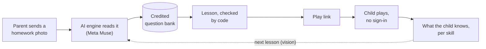
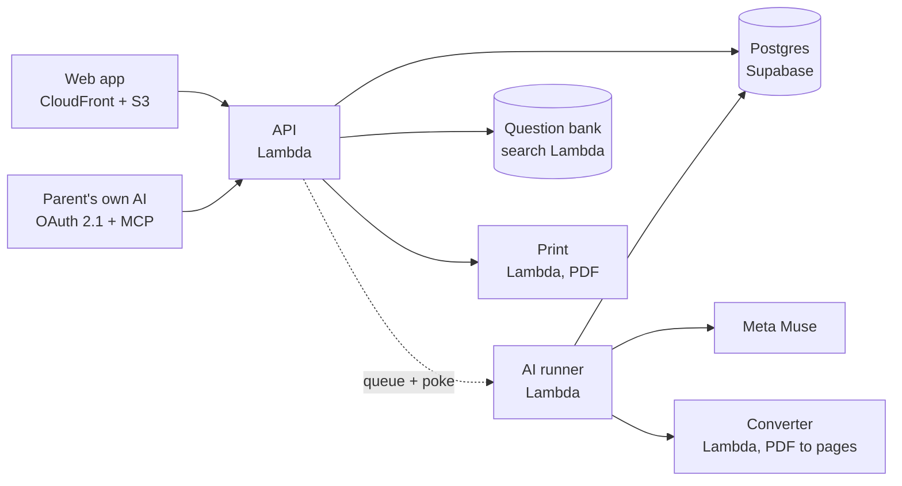

# Jadwigo

A learning app for children in the first school grades, in Polish and English. A parent photographs a homework page, and Jadwigo builds a lesson from a credited question bank. The child plays it from a link, with no sign-in.

Built in 10 days, from 2026-10-26 to 2026-11-04, by Vasyl and AI agents. On demo day a whole class used it to practise for a test.

## Try it

- **Play a lesson:** [Adding and taking away to 20](https://app.jadwigo.pl/play/asg_67ppftwzj9a4ttbtftc3mn4z45), no account needed
- **Make a lesson:** sign in at [app.jadwigo.pl](https://app.jadwigo.pl) and send a photo of homework
- **Connect your own AI:** add `https://app.jadwigo.pl/api/mcp` to claude.ai, ChatGPT or Claude Code ([how](https://docs.jadwigo.pl/features/connect-your-ai/))

## Links

| | |
| --- | --- |
| Website | [jadwigo.pl](https://jadwigo.pl) (Polish) · [jadwigo.pl/en](https://jadwigo.pl/en/) (English) |
| About us | [O nas](https://jadwigo.pl/o-nas/) · [About](https://jadwigo.pl/en/about/) |
| Docs | [docs.jadwigo.pl](https://docs.jadwigo.pl): [What's built](https://docs.jadwigo.pl/built/) · [What's next](https://docs.jadwigo.pl/next/) · [Story](https://docs.jadwigo.pl/story/) |
| How it's built | [Architecture](https://docs.jadwigo.pl/architecture/) · [Building with agents](https://docs.jadwigo.pl/architecture/building-with-agents/) · [Experiments](https://docs.jadwigo.pl/experiments/) |
| For developers | [API reference](https://docs.jadwigo.pl/api/) · [MCP](https://docs.jadwigo.pl/mcp/) · [Design system](https://docs.jadwigo.pl/design-system/) |

## Lesson flow



Meta Muse reads the photo, picks questions from the bank and drafts the lesson. Plain TypeScript then checks the lesson and grades each answer. The parent sees the lesson before the child does.

## Architecture



All serverless: 5 Lambda functions, static files behind CloudFront, managed Postgres and sign-in. [Architecture](https://docs.jadwigo.pl/architecture/) goes from this picture down to each part.

## Repo

TypeScript with bun workspaces and Turborepo, plus a uv project for the `jw` CLI. Apps live in `apps/`, shared code in `packages/`, Terraform in `infra/` and migrations in `supabase/`.

```sh
mise install                       # Node 24, bun, uv, gitleaks
bun install --frozen-lockfile
make check                         # lint, typecheck and test what changed
```

Agents build this repo: start with [AGENTS.md](AGENTS.md) for the commands and the rules, and [docs/README.md](docs/README.md) for the workstreams. Words are in [GLOSSARY.md](GLOSSARY.md). 