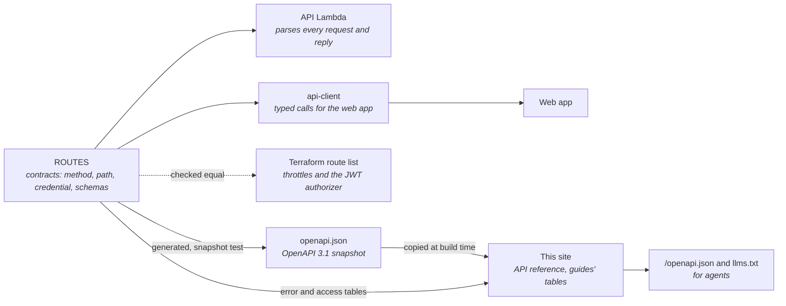
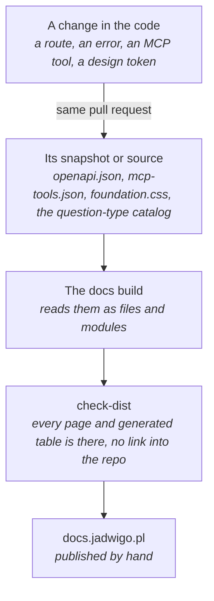

Every route, record and error is defined once, as a Zod schema in the `contracts` package. The
route table, `ROUTES`, names each route's method, path, credential, body and reply. Everything
else is built from it or checked against it.

## One table, many readers

- **The API** looks up each route in the table and parses the request and its own reply against
  the route's schemas. A handler never trusts its input.
- **The client** takes its types from the same schemas, so a changed field is a type error in the
  web app before anything runs.
- **The infrastructure** lists every route too, because API Gateway needs each one to throttle it
  and to put the JWT authorizer on the parent routes. A check compares that list with `ROUTES`
  and fails the build when they differ, so a new route can't slip past its limits.
- **The OpenAPI document** is generated from the table and kept as a snapshot. A test fails when
  the document and the snapshot differ, so a contract change is always visible in review.

## The living-docs loop

This site is built from the code each time it is published. A table the code can make is
generated, never typed by hand.

| What changes | Where it shows here |
| --- | --- |
| A route, its body or its reply | [API reference](/api/), from the OpenAPI document |
| An error type or its status | The table in [Errors](/guides/errors/) |
| Which credential a route takes | The tables in [Authentication](/guides/authentication/) |
| An MCP tool, its arguments or its reply | [MCP](/mcp/), from the tool list `jw` writes |
| A design token | [Tokens](/design-system/tokens/), from the stylesheet |
| A question type | [Question types](/design-system/question-types/), from the lesson kit's catalog |

The rule that keeps the loop closed: a change to a route, an MCP tool or a design token brings its
docs in the same pull request. For a generated table that is free, since the next build redraws
it. A written page is updated by hand.

Before a publish, `check-dist` reads the built site. It fails when a page or a generated table is
missing, or when any page links into the source repository: these docs restate what a reader
needs and stand on their own.
