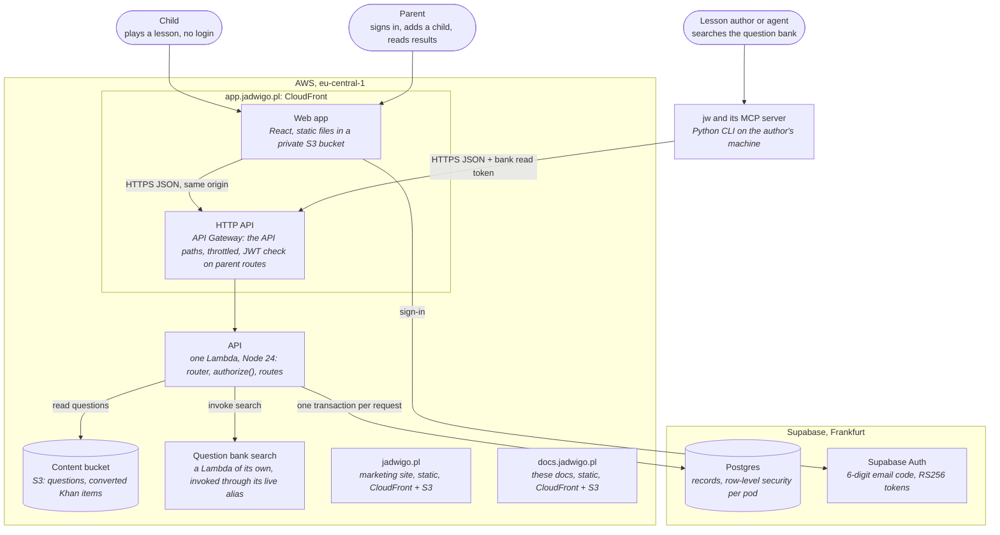
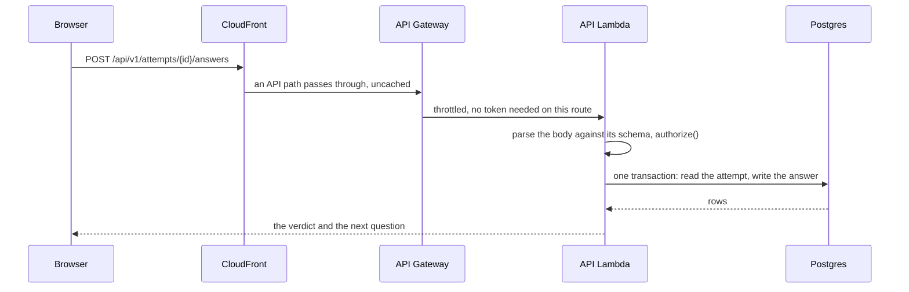

This page is for anyone who wants the whole system on one page: its parts, where each runs, and
how a request moves through them.

Jadwigo is one web app, one API and one database, with 2 static sites beside them. Everything runs
in AWS in Frankfurt (`eu-central-1`), and the database and sign-in are a Supabase project in the
same region.

## The containers

The diagram is drawn in your browser from its text.

## What each part does

- **Web app** at `app.jadwigo.pl`: the lesson player and the parent's screens. It is a single-page
  app: any path without a file extension loads the same `index.html`, so a link such as
  `/play/<id>` opens the app. It calls the API only through the shared typed client.
- **HTTP API**: the same host serves the API, uncached: every path under `/api/v1/`, and
  `/api/health`. So the app and the API share one origin
  and need no CORS. Every route but `/api/health` is throttled at 10 requests a second, with a burst
  of 20. The parent routes carry a JWT authorizer that checks the Supabase token before the
  Lambda runs.
- **API**: one Lambda holds every route. It parses each request against its schema, runs
  `authorize()` first, and runs the whole request as one database transaction. In AWS it
  reads its database URL once per cold start from an encrypted parameter, so the secret is never in
  the function's settings.
- **Postgres**: every record. Row-level security keeps each pod's rows to that pod, and the API
  holds one pooled connection per running Lambda instance.
- **Supabase Auth**: signs a parent in with a 6-digit email code. The token is RS256, so API
  Gateway can verify it with no shared secret.
- **Question bank**: the credited question sets lessons are composed from. It lives outside the
  repo. The API reaches it in 2 ways: it invokes the bank's search function for a search, and reads
  a question's body from the content bucket. Nothing else calls the bank directly.
- **jw**: the command-line tool for lesson authors, with an MCP server (`jw mcp serve`) for AI
  agents. It talks to the API over HTTPS like any other caller, with the bank read token for the 2
  bank routes. See [MCP](/mcp/).
- **jadwigo.pl** and **docs.jadwigo.pl**: static sites, built and uploaded by hand. They call
  nothing at runtime.

## A request, end to end

A parent route goes the same way, with one more step: API Gateway refuses a missing or bad token
with `401` before the Lambda runs. The Lambda then finds the caller's member row and its pod.

## Deploys

A merge to `main` deploys nothing. The owner deploys by hand: the API's code, the web app's files,
the marketing site and these docs each have their own step. Infrastructure is Terraform, applied
by hand too.

## Next

- [Monorepo](/architecture/monorepo/): the apps and packages, and who may import whom.
- [Contracts and generated docs](/architecture/contracts/): how one route table feeds the API,
  the client and this site.
