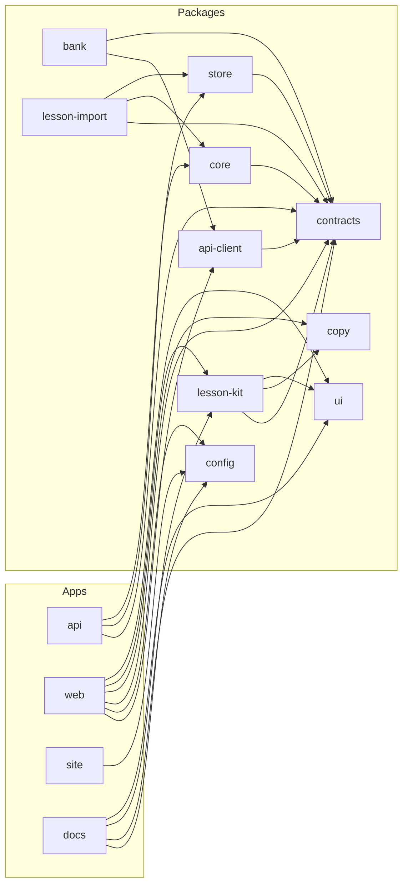

This page is for anyone finding their way around Jadwigo's code: the apps and packages it is built
from, which way imports may go, and the rules the build holds.

All of Jadwigo's code lives in one repository: TypeScript apps and packages in one workspace,
and a Python command-line tool beside them. A change to a schema and every caller it breaks land
in the same pull request.

An app runs, and nothing imports an app. A package is imported. Each package has one job and one
public entry, which is all other code imports.

## Who imports whom

Each arrow is a runtime dependency: the app or package on the left imports the one it points to.

A test checks this diagram against the workspace's own dependency lists, so an edge added in the
code and not here fails the docs build.

## Rules the build enforces

Each of these is a check that runs on every pull request, and each has a test that plants a
violation to prove the check still catches it.

- **Apps import packages, never the reverse.** A package that imports an app fails.
- **`contracts` is the bottom.** It imports Zod and nothing of ours, so every other part can
  depend on it.
- **No cycles**, and no import that does not resolve.
- **Test helpers stay in tests.** Only test files import the `testing` package.
- **Inside `lesson-kit`, parts know no family.** A part draws for any family, so it never imports
  one. Heavy libraries stay in one place: drag and drop only in the 3 drag parts, TeX only in rich
  text.
- **Strict TypeScript.** Ids are branded types that only the contract parsers create, and an
  index into an array may be undefined.
- **The environment is read in one file per app**, its `config.ts`. An error type, a route path
  or an id prefix is written through its constant from `contracts`, never retyped.
- **No unused code.** An unused file, export or dependency fails.
- **No question bank in git.** No question pages, Khan items, database files or media, and no
  file over 1 MB.
- **Unit tests run offline.** A unit test fails on a network call, on real AWS and on an unpinned
  clock. Anything that needs those is an integration test.

## Every app

| App | What it is |
| --- | --- |
| `api` | The one Lambda: the router, `authorize()` and the routes. |
| `web` | The app at app.jadwigo.pl: the lesson player and the parent's screens. |
| `site` | The marketing site at jadwigo.pl. |
| `docs` | This site, docs.jadwigo.pl. |
| `cli` | `jw`, in Python: question search for lesson authors, and its MCP server. It imports none of the TypeScript code and talks to the API over HTTP. |

## Every package

| Package | What it holds |
| --- | --- |
| `contracts` | Zod schemas for everything that crosses a boundary: ids, records, the answer wire, the route table and the errors. |
| `core` | Grading, numbers and mastery, as pure functions. |
| `store` | The `Store` interface, an in-memory store and a Postgres store, and one contract suite both pass. |
| `api-client` | The typed client the web app calls the API with. Its types come from the contracts, never written by hand. |
| `config` | The hosts and languages of every environment, in one place. A domain name written anywhere else is a bug. |
| `lesson-kit` | The interaction families and the lesson blocks built on them. |
| `ui` | The design tokens and the shadcn/ui primitives. See [Design system](/design-system/). |
| `copy` | Every string a person reads, in Polish and English. |
| `lesson-import` | Compiles a lesson file from the playground into lesson questions and a published version. |
| `bank` | Code to read, search and import the question bank. Never the questions themselves. |
| `testing` | Fixtures, factories and the unit setup, for test files only. |

## Next

- [Contracts and generated docs](/architecture/contracts/): how the `contracts` package feeds the
  rest.
- [Design system](/design-system/): what the `ui` package draws.
