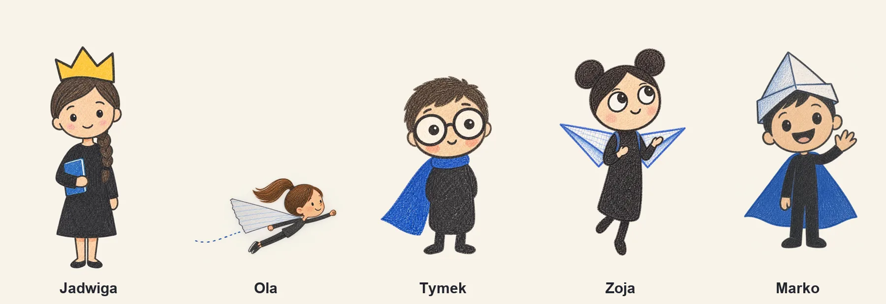
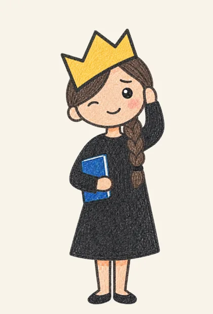

Jadwigo's characters are drawings from a child's school notebook that came to life. Queen Jadwiga
is the calm voice. Her class of cape heroes, **Klasa Królowej**, brings the motion. They are all
drawn in one style, **kredki**: coloured pencil and wax crayon on cream paper.

## The style

- **The medium:** coloured pencil and wax crayon on cream paper. Pencil strokes and paper tooth
  show, the edges are soft, and the outline is a confident dark pencil line of even weight.
- **The feel:** a talented 10-year-old's drawing, tidied by a careful illustrator. Shapes are
  simple.
- **Faces and bodies:** a big head on a small body, about 1 to 2.5. Dot eyes with a small white
  highlight, simple brows, a small mouth and a light rosy cheek.
- **The palette** is Zeszyt's:
  - pencil black for clothes and outlines;
  - ink blue (`--jw-p-ink-650`) for capes, wings and scarves;
  - the crown's yellow (`--jw-crown`) on Jadwiga's crown and nowhere else;
  - natural skin tones and dark brown hair;
  - white paper and pencil grey for anything folded from paper.

The pencil texture is why this style was chosen over a clean vector. It sits on the same notebook
paper as the lesson, and it looks drawn by hand.

## Rules every drawing keeps

- **No green and no red on a character.** In a lesson they mean right and miss, and nothing else.
- **Only Jadwiga wears a crown.** It has 3 points: a taller middle point and one at each side, on a
  flat band. It is the only yellow on the cast, so there are no yellow hair ties, buttons or shoes.
  Help keeps its own, paler yellow.
- **Every character has 2 arms with small hands.** Wings, capes and scarves never replace them.
- **No emblem on a cape, and no text or letters anywhere.**
- **Faces are kind.** No character is sad, mocking or disappointed at the child. When there is a
  joke, it is on the character.
- **Each character reads as a solid black shape at 64 px.** The crown, the ponytail, the glasses,
  the buns and the paper hat each make a distinct outline.
- **A character image has a transparent background**, with no floor and no shadow, so it can sit in
  any margin.

## Where they appear

Characters live in the margins of a lesson page. They never cover the answer, the options or the
action button.

- **A hero flies across the top margin** after 3 right answers in a row, with a dotted pencil trail
  behind. The child can press Dalej while the hero is still flying.
- **On a miss, Jadwiga's crown slips** over one eye. She pushes it back with a wink, in the bottom
  margin above the band.
- **A hero peeks out from a help note** and points at it.

With reduced motion on, each moment shows only its last frame.

## How the drawings are made

Each character has one approved drawing, its **anchor**. Every new image of a character starts from
that anchor and changes one thing at a time, so the cast stays recognisable across poses and
scenes. The drawings are generated with an image model and checked against the rules above. Only
approved final art enters the app.

## Every character

| Character | Who they are | Their marks |
| --- | --- | --- |
| **Jadwiga** | The queen, about 10. Calm, kind and a little clumsy. She doesn't fly. | Crown; one long brown plait; black A-line dress; a blue notebook under her arm |
| **Ola** | A hero. Fast and straight. | Tall and slim; a high ponytail, nothing on her head; a cape torn from a lined notebook page |
| **Tymek** | A hero. Careful and thoughtful; his landings wobble. | Short and round; big round glasses; a long blue scarf worn as a cape |
| **Zoja** | A hero. Dreamy; she glides and loops. | Two round buns; paper-plane wings folded from notebook paper |
| **Marko** | A hero. A cheerful joker who waves hello in 2 languages. | A pointed hat folded from white paper; a wide blue cape |

Jadwiga is named after Queen Jadwiga, and "Jadwigo!" is the Polish way of calling her. A teacher
character may join the class later, but only with the teacher's written consent.

## Next

- [Tokens](/design-system/tokens/): the colours the drawings take, `--jw-crown` among them
- [Design system](/design-system/): Zeszyt, the notebook the characters live in
