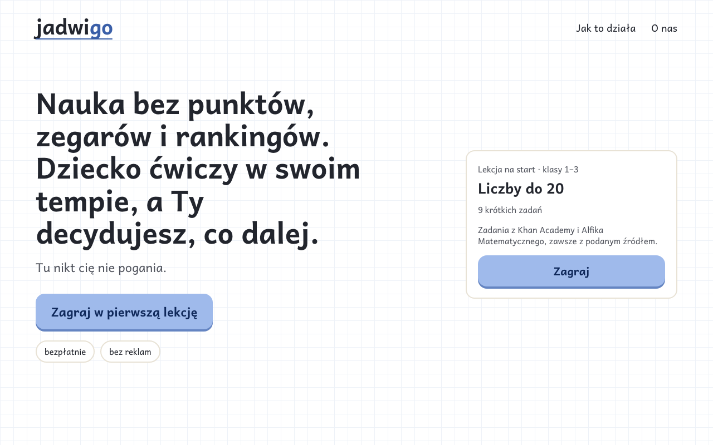
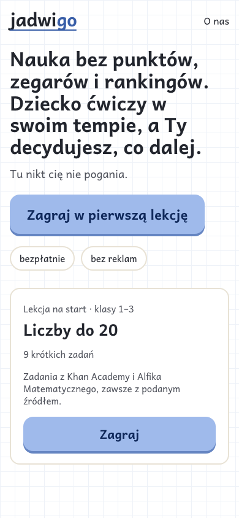
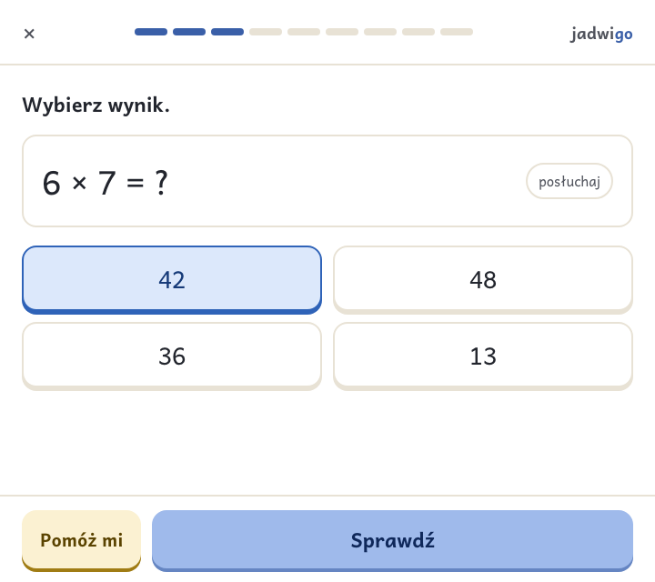
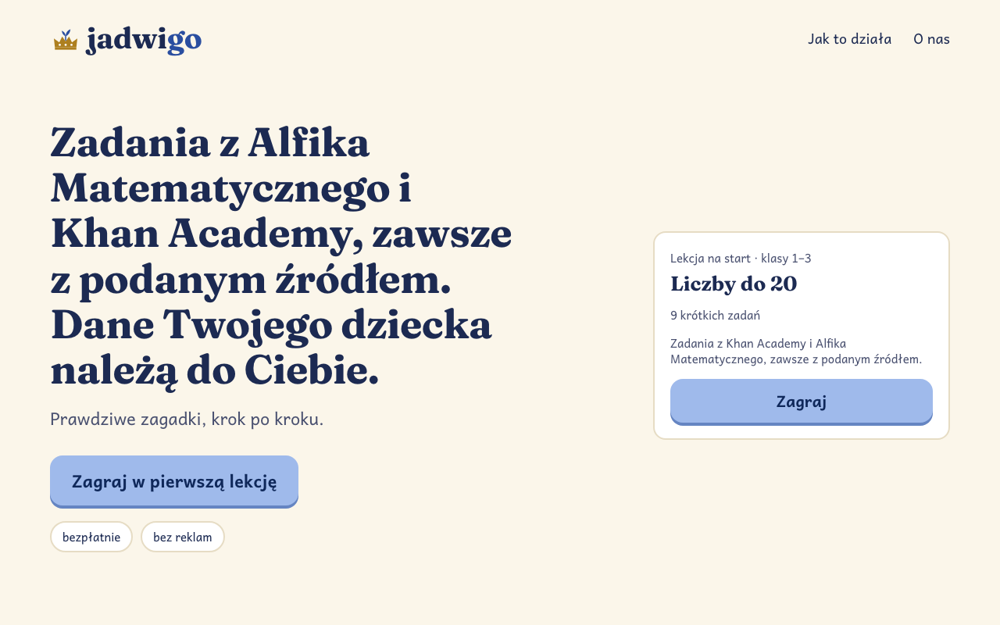
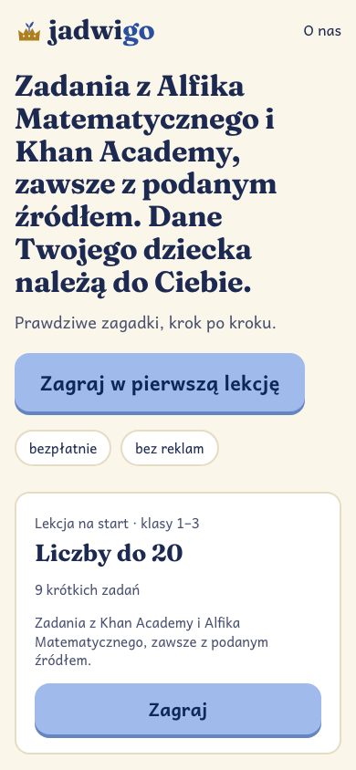
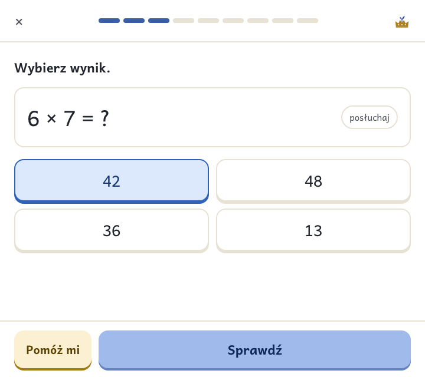
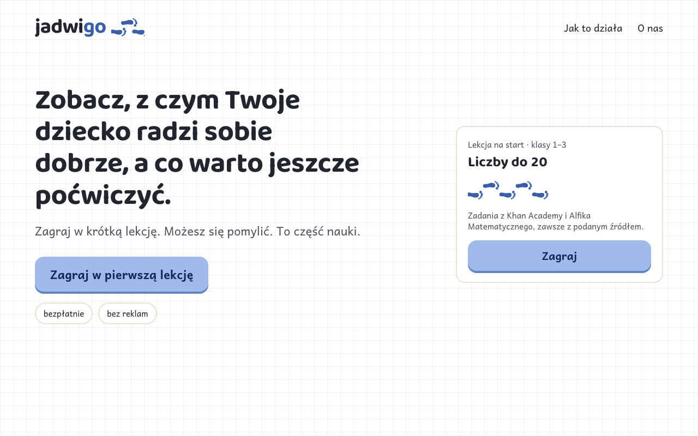
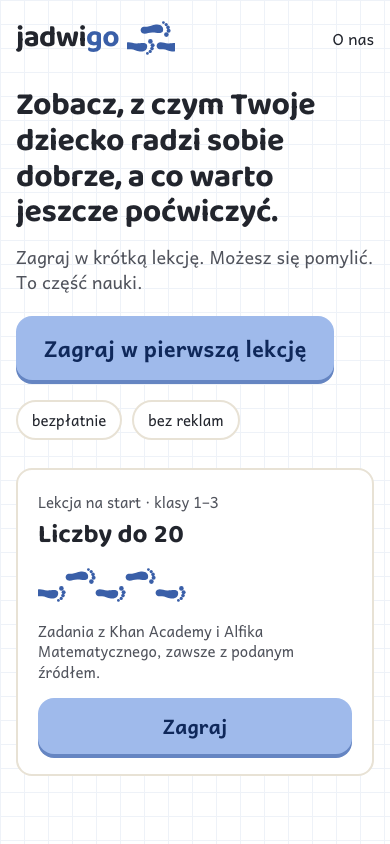

:::meta
eyebrow: Jadwigo · identity
subtitle: 3 wordmark, palette and type options, each on the jadwigo.pl hero, a phone and a lesson card
by: the jadwigo-marketing session for dl-w0b4.27
when: 2026-10-27T15:00:00Z
:::

# Look: Zeszyt, Królewski zeszyt and Ślad

Every option keeps Zeszyt on the lesson. Zeszyt is white paper, blue ink for the one thing to press, the teacher's green and red pen, and Andika. An option changes only the wordmark, what the site wraps around the lesson, and where the brand touches the lesson frame. Every typeface here is under the [SIL Open Font License](fonts/andika-LICENSE.txt), self-hosted, and licensed for web and app use.

## Zeszyt

The wordmark is plain [Andika Bold](fonts/andika-latin-700-normal.woff2) in ink, with "go" in the child's blue ink and a ruled line under it. Around it, the site is the lesson's own paper with a faint squared grid. Nothing new is added to Zeszyt. It leans toward lead B, calm.

## Królewski zeszyt

The wordmark is in Fraunces, a soft serif, next to a small paper-cut crown with a sprout growing from it. Behind it, the site sits on cream with royal blue, and warm gold is kept for the crown alone, as in a wycinanka. Lessons keep Zeszyt's white paper. It leans toward lead C, trust.

## Ślad

The wordmark is in [Baloo 2](fonts/baloo-2-LICENSE.txt), round and warm, and a trail of small footprints in the child's blue ink leads away from it. On the lesson, the step bar becomes that trail, so a child sees how far they have walked, never a score. It leans toward lead A, clarity.

## Side by side

:::table The looks side by side, from [data/identity.json](data/identity.json)
| | Zeszyt | Królewski zeszyt | Ślad |
| --- | --- | --- | --- |
| Wordmark face | Andika 700 (SIL) | Fraunces 700 (The Fraunces Project Authors) | Baloo 2 700 (The Baloo 2 Project Authors) |
| Site headlines | Andika | Fraunces | Baloo 2 |
| Everything a child reads | Andika | Andika | Andika |
| Site ground | white, squared grid | cream #fbf6ea | white, squared grid |
| Brand colour | blue ink #3a5fa8 | royal blue #2a4ea0, gold #ad7f1f (crown only) | blue ink #3a5fa8 |
| On the lesson | wordmark in the top bar | crown in the top bar | the step bar as footprints |
| Leans toward | B, calm | C, trust | A, clarity |
:::

<!-- contrast:start -->
:::table Contrast of every text pair by day and by night, from [data/contrast.json](data/contrast.json) against the [WCAG contrast minimum](https://www.w3.org/TR/WCAG21/#contrast-minimum)
| Look | Pair | Kind | Day | Night |
| --- | --- | --- | --- | --- |
| Zeszyt | ink on ground | text | 15.3:1 | 13.6:1 |
| Zeszyt | inkSoft on ground | text | 7.7:1 | 8:1 |
| Zeszyt | accent on ground | text | 6.2:1 | 8.2:1 |
| Zeszyt | onAct on act | text | 7.3:1 | 5.3:1 |
| Królewski zeszyt | ink on ground | text | 13:1 | 14.4:1 |
| Królewski zeszyt | inkSoft on ground | text | 7.2:1 | 9:1 |
| Królewski zeszyt | accent on ground | text | 7.2:1 | 8.6:1 |
| Królewski zeszyt | onAct on act | text | 7.3:1 | 5.3:1 |
| Królewski zeszyt | goldInk on ground | text | 6.8:1 | 10.5:1 |
| Królewski zeszyt | gold on ground | mark | 3.3:1 | 8.3:1 |
| Ślad | ink on ground | text | 15.3:1 | 13.6:1 |
| Ślad | inkSoft on ground | text | 7.7:1 | 8:1 |
| Ślad | accent on ground | text | 6.2:1 | 8.2:1 |
| Ślad | onAct on act | text | 7.3:1 | 5.3:1 |
| Ślad | noteInk on note | text | 8.3:1 | 10.7:1 |
:::
<!-- contrast:end -->

:::aside
Red still means a miss and green still means right, in every option, so no look spends either on decoration. The same rule is why "green for go" is left out of the "go" ideas on the [name page](name.html).
:::
