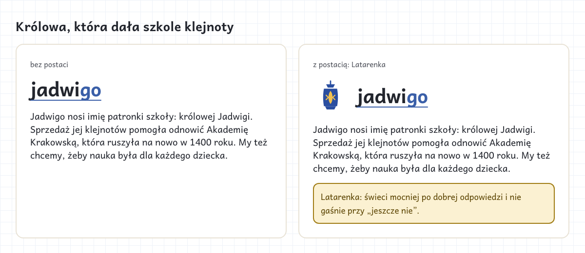
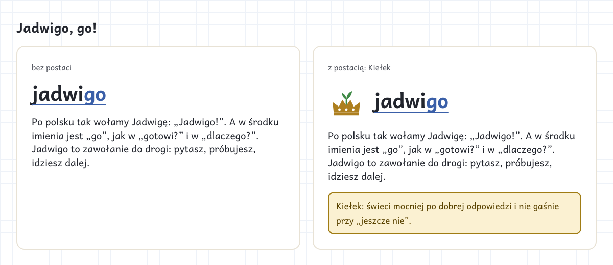
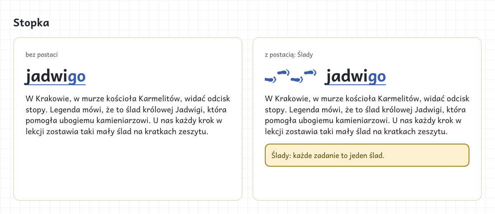

:::meta
eyebrow: Jadwigo · identity
subtitle: Stories about a school's patron, Queen Jadwiga, each with and without a character, and ideas from the "go" in the name
by: the jadwigo-marketing session for dl-w0b4.27
when: 2026-10-27T15:00:00Z
:::

# The name story, and whether a character carries it

Jadwigo is named after a school's patron, Queen Jadwiga. In Polish you call a Jadwiga "Jadwigo!", and in English the name reads as "Jadwiga, go!". Each story rests on these facts:
- She was [crowned "King" of Poland in Kraków](https://en.wikipedia.org/wiki/Jadwiga_of_Poland) on 16 October 1384.
- The sale of her jewellery [helped restore the Kraków Academy](https://en.wikipedia.org/wiki/Jadwiga_of_Poland), whose charter came on 26 July 1400.
- She was [canonised](https://en.wikipedia.org/wiki/Jadwiga_of_Poland) on 8 June 1997.
- A [folk legend](https://www.trasadlabobasa.pl/en/tab/articles/legend_of_queen_jadwiga's_footprint/5) says a footprint in the wall of Kraków's Carmelite church is hers.

This repo names only the patron, never the school (`jadwigo-marketing/decisions/2026-10-27-the-jadwigo-repo-names-only-the-patron-queen-jadwiga-never-the-s`).

## Królowa, która dała szkole klejnoty

The queen who gave her jewels to a school. Its character is Latarenka, a paper-cut lantern that lights the next step.

## Jadwigo, go!

The vocative as a call: you ask, you try, you go on. Its character is Kiełek, a soft crown with a sprout that grows a leaf as the child moves on and never wilts.

## Stopka

The footprint legend as a trail of steps on squared paper. There is no figure: the footprints are the character.

## Characters: what weighs on the choice

- **For:** the charter wants "characters that make a child smile". Khan Academy Kids gives its bear the job of cheering a right answer and showing how to think after a miss.
- **Against:** Zeszyt keeps decoration off the lesson ("decoration costs attention"). Under lead B (calm), a loud mascot fights the message.
- **A don't-scale option:** the class draws and names the character. That character is the most "ours", but it needs the parents' and the teacher's consent, and the drawings stay outside git.
- **Never:** the queen as a portrait, or anything that looks like another product's character.

## "Go" in the name

:::table Where each idea would live
| Idea | Where it lives | Fits lead |
| --- | --- | --- |
| "Jadwigo, go!", the call | the wordmark sets "go" apart in blue ink | all |
| GOtowi?: "gotowi" starts with "go" | the child's welcome: "Gotowi? Go!" | A, C |
| dlaczeGO?: Polish questions end in "-go" | the headline "Każde „dlaczego” to dobry początek." | A |
| Krok po kroku: going means walking | the footprint trail and the step bar | A, B |
| A Go board on squared paper | each answer a stone, a quiet step bar | B |
| A paper plane from a zeszyt page | a celebration move for the illustration style (`dl-w0b4.18`) | B, C |
| Green for go | left out: green means "right" only in Zeszyt | none |
:::

:::aside
Each story also sits beside the family's own: "Tę aplikację zrobiliśmy najpierw dla naszego syna. Teraz otwieramy ją dla jego klasy, a potem dla całej szkoły." See the [O nas mock](rings.html).
:::
