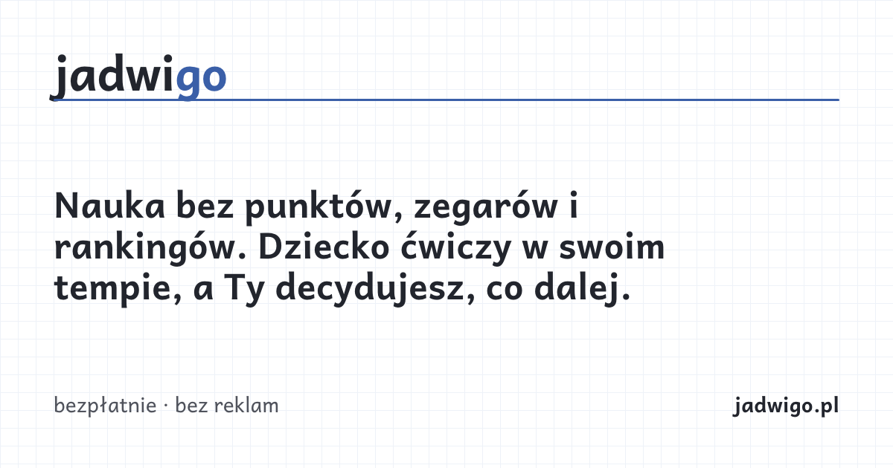
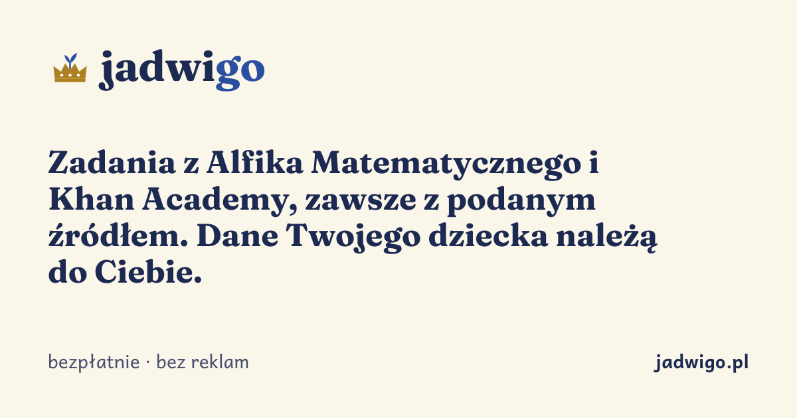
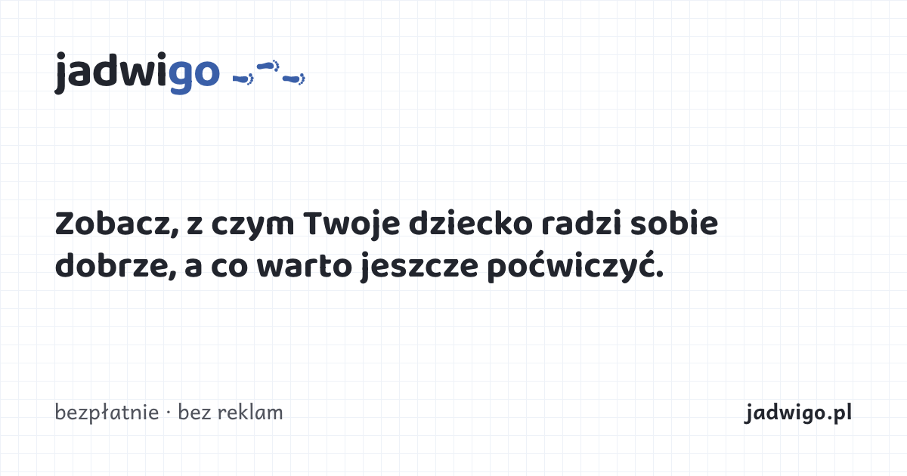
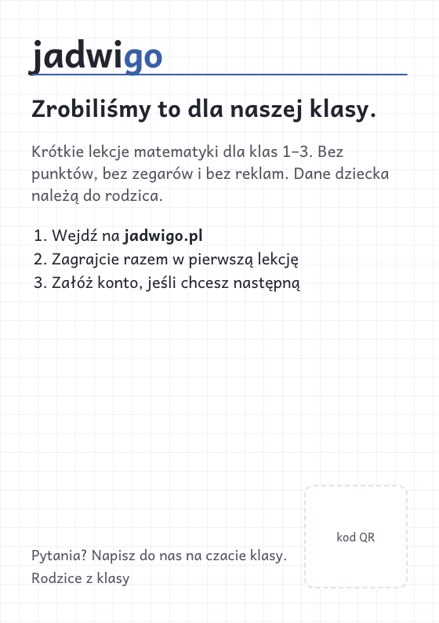
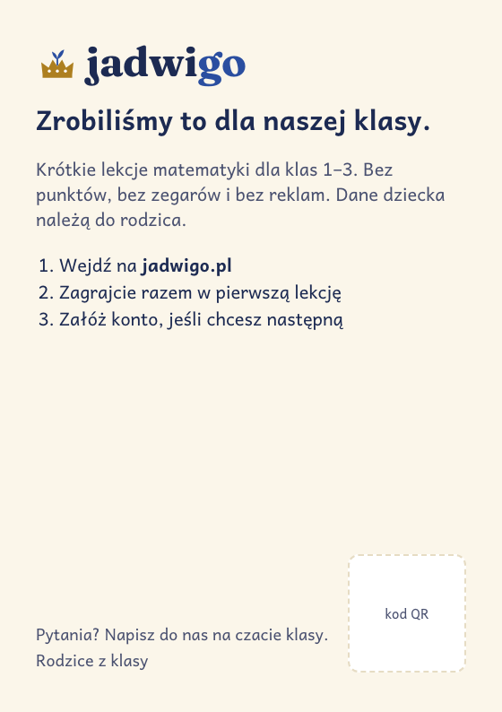
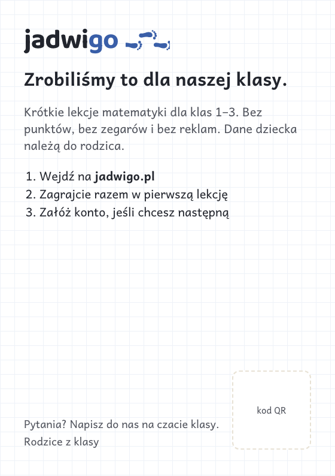
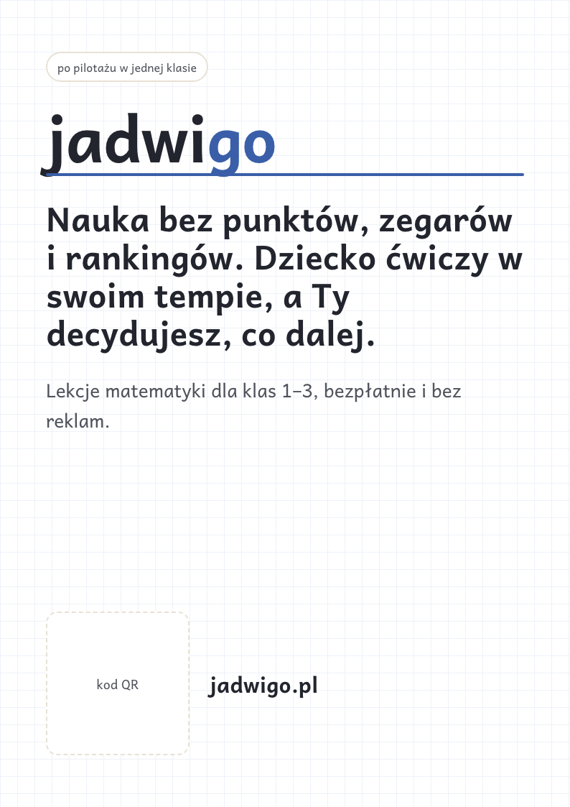
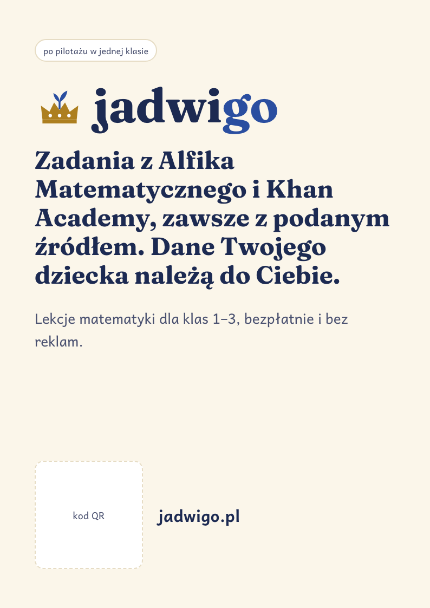
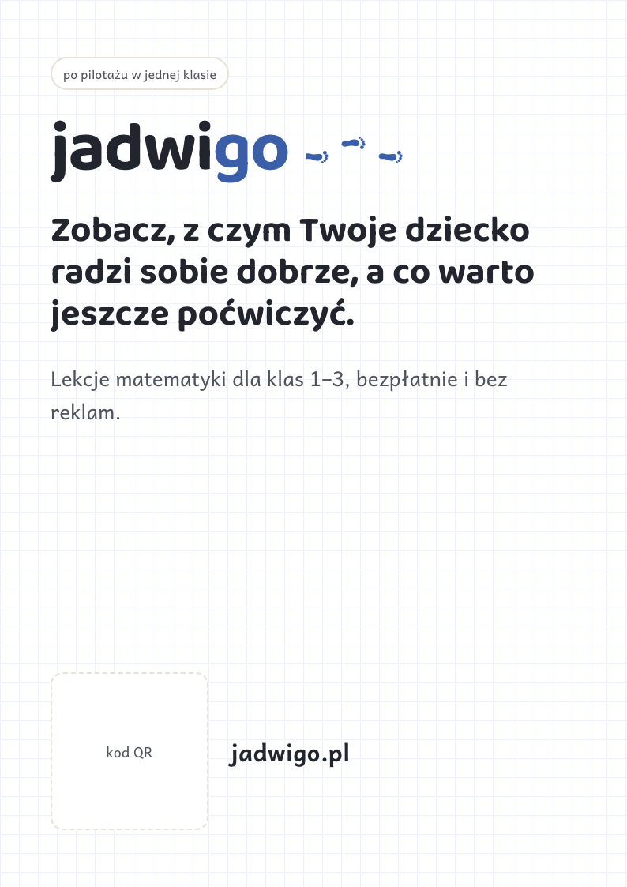
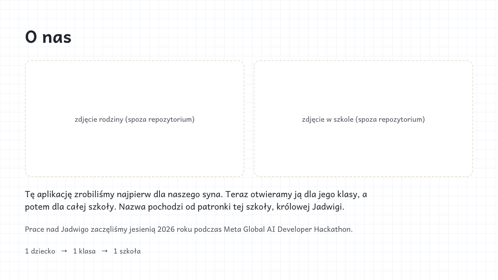

:::meta
eyebrow: Jadwigo · identity
subtitle: Do things that don't scale. Each look on the class chat's link card, a printed invitation and a school poster
by: the jadwigo-marketing session for dl-w0b4.27
when: 2026-10-27T15:00:00Z
:::

# Child, class, school: where the first families see Jadwigo

Jadwigo began at the Meta Global AI Developer Hackathon, under its "Build for Your World" theme: a parent building for his own child. It grows the way Paul Graham's "Do Things That Don't Scale" describes. First comes one child, then his class ([the 18-child pilot](https://github.com/vasyl-stanislavchuk/jadwigo-hackathon/blob/main/docs/research/jadwigo-go-to-market.md), `dl-e5c4`), then his school. Jadwigo does not start with a market (`jadwigo-marketing/decisions/2026-10-27-jadwigo-does-things-that-don-t-scale-the-child-first-then-his-cl`).

So the hero is not where most parents first meet Jadwigo. They meet it in other places, and each look is tried on each of them.

## The class chat: the link card

A parent pastes jadwigo.pl into the class chat, and the chat shows this card, the Open Graph image. Most of the class's parents will see this card first.

## On paper: an A6 invitation

A card handed out at the school door, from the family to the class's parents. The card gives the steps to start and a QR code, and carries no family name.

## School poster

A poster for the school's notice board comes only after the pilot verdict, so each poster says so.

## O nas page

Our founder story, why we do it and for whom, goes on an "O nas" page with the family's photos (`jadwigo-marketing/decisions/2026-10-27-jadwigo-pl-will-have-an-o-nas-story-with-the-family-s-photos-why`). This mock shows empty frames, because no family photo or name goes into the repo. Where the photos live, and how the child is shown, are the owner's to decide (`dl-w0b4.41`).

## What the rings ask of a look

:::table Each look against the rings, read from the mocks above
| | Zeszyt | Królewski zeszyt | Ślad |
| --- | --- | --- | --- |
| Feels made by a parent | yes: it is the child's own notebook | less: the crown and serif read as a brand | yes: footprints drawn on squared paper |
| At a 300 px chat preview (checked) | the wordmark and headline read | they read; the crown is still a crown, but tiny | they read; the footprints shrink to dots |
| Prints in 1 colour | yes | the gold needs a second colour | yes |
| Fits the school notice board | quiet | stands out most | friendly |
:::

:::aside
The class invitation kit, the real link card and a printable A6 PDF, is filed as `dl-w0b4.43`. It waits on the look pick and on how the invite reaches the parents (`dl-w0b4.31`).
:::
