:::meta
eyebrow: Jadwigo · parent login
subtitle: What the owner does by hand in Google Cloud, Meta and Supabase, in order, and what agents build in the repo.
by: the jadwigo platform session, for issue dl-e8ov.2.50
when: 2026-10-29T18:00:00Z
:::

# Owner steps

Every step here makes an account with a third party, publishes Jadwigo's name, or handles a secret, so the owner runs it. The full runbook, with what you should see after each step, is [`docs/runbooks/social-sign-in.md`](https://github.com/vasyl-stanislavchuk/jadwigo-hackathon/blob/main/docs/runbooks/social-sign-in.md).

## Google

`dl-e8ov.2.53`

1. Create the Google Cloud project `jadwigo`.
2. Set up the Google Auth Platform with an External audience.
3. Add the name, logo, home page, privacy link and terms link.
4. Authorize the domain `jadwigo.pl`, and leave `supabase.co` out.
5. Keep the scopes to `openid`, `email` and `profile`.
6. Publish the app, then submit the branding for verification.
7. Create one Web client for `jadwigo-dev` and one for `jadwigo-prod`, each with its Supabase callback.
8. Paste each secret into the keychain, and record each client id on the issue.

## Meta

`dl-e8ov.2.54`

1. Register as a Meta developer, and create the business portfolio `Jadwigo`.
2. Create the app `Jadwigo` with the use case "Authenticate and request data from users with Facebook Login".
3. Check that `email` and `public_profile` both say "Ready for testing".
4. Add both Supabase callbacks to Valid OAuth Redirect URIs.
5. Fill in the icon, the privacy and terms links, and the app domains.
6. Paste the app secret into the keychain, and record the app id on the issue.
7. Add testers for dev.
8. Once the deletion page is live, ask for App Review of `email`, then switch the app to Live.

## Supabase

After `dl-e8ov.2.52` lands, run `infra/supabase-auth/auth.sh diff dev`, then `auth.sh apply dev` from your own terminal. Then try both buttons on `jadwigo-dev` with an email you already signed in with.

## Rollout

:::table Rollout, by stage
| Stage | Who can sign in with Google or Facebook | What it waits on |
| --- | --- | --- |
| Dev, Google | any Google account, with Google's warning until branding is verified | `dl-e8ov.2.51`, `dl-e8ov.2.52`, `dl-e8ov.2.53` |
| Dev, Facebook | only the testers on the Meta app | the same, with `dl-e8ov.2.54` in place of `dl-e8ov.2.53` |
| Prod | any parent | the lawyer's consent text `dl-e8ov.2.9`, verified branding, Meta's review, and the host answer `dl-e8ov.2.55` |
:::
