:::meta
eyebrow: Jadwigo · parent login
subtitle: Where a Google or Facebook sign-in lands, how the tab leaves and comes back, and which parent it becomes.
by: the jadwigo platform session, for issue dl-e8ov.2.50
when: 2026-10-29T18:00:00Z
:::

# The design

Supabase Auth stays the only thing that knows who a parent is. Google and Facebook become more ways into the same Supabase user, next to the email code.

## Where a sign-in lands

Supabase keeps one row in `auth.users` per person and one row in `auth.identities` per way in. A parent who uses the email code and Google has one user with an identity for each. Every identity shares the user's id, which is the `sub` that Jadwigo's `account` is keyed on.

**Nothing on Jadwigo's side changes.** A token minted after a Google sign-in has the same issuer, audience and signing key as one minted after the email code. So there is no migration, no new contract, no new API route and no change to the gateway.

## Same-tab redirect

The parent taps **Continue with Google**. The tab goes to Supabase, then to Google, then back to Supabase, then back to `/parent` with a one-time code in the URL. The page swaps the code for a session, then carries on exactly as it does after the email code.

- **The attempt id survives.** The tab leaves and comes back, but it is the same tab, so `sessionStorage` still holds the attempt id for the claim.
- **The code is useless on its own.** Before leaving, supabase-js keeps a random verifier in the tab. Only that tab can turn the code into a session. Supabase calls this the PKCE flow ([Supabase's Google guide](https://supabase.com/docs/guides/auth/social-login/auth-google)).
- **No new allow-list entry.** The page comes back to `/parent?claim=…` itself. Prod's list already allows `https://app.jadwigo.pl/**`, and dev's allows `localhost` on any port.
- **Only `/parent` reads the code.** The client keeps `detectSessionInUrl: false`, so no other page acts on a `?code=` it did not expect.

## Which parent it becomes

Supabase links a new identity to an existing user when the provider returns a verified email that matches ([identity linking](https://supabase.com/docs/guides/auth/auth-identity-linking)). Supabase's source shows where "verified" comes from: Google sends `email_verified`, and every email Facebook returns is taken as verified ([`facebook.go`](https://github.com/supabase/auth/blob/master/internal/api/provider/facebook.go)).

**A sign-in with no email never makes a family.** Supabase refuses it with "Error getting user email from external provider" ([`external.go`](https://github.com/supabase/auth/blob/master/internal/api/external.go)), and `/parent` shows a kind line offering the email code. We keep Supabase's `email_optional` setting off, so a parent can't end up with an account that no email code could ever reach.

## What we store

Nothing new in Jadwigo's tables. Google and Facebook do put the parent's full name and avatar URL into Supabase's user metadata, and that metadata rides in every token. Whether to trim it is `dl-e8ov.2.16`, which now covers both providers.

## Code changes

:::table Code changes, by issue
| Issue | Where | What |
| --- | --- | --- |
| `dl-e8ov.2.51` | `apps/web/src/parent`, `packages/copy`, the e2e stand-in | 2 buttons, the code exchange on `/parent`, the no-email line, new copy keys in `pl` and `en` |
| `dl-e8ov.2.52` | `infra/supabase-auth` | provider ids and on-switches in `dev.json` and `prod.json`. `auth.sh` reads each secret from the keychain and never prints it |
:::

The Playwright stand-in for Supabase grows a fake `/authorize` and `/token`, so CI tests the round trip with no provider. A real Google or Facebook sign-in is the owner's check on `jadwigo-dev`.
