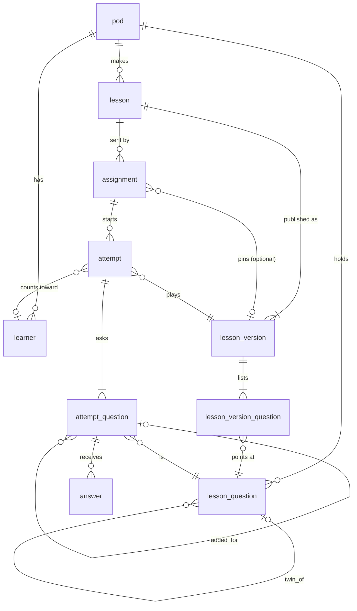

# What is the smallest data model that plays a lesson from the database and keeps every answer?

Issue: `dl-e8ov.5.34`

## The answer in 5 lines

1. Ten tables: `pod`, `learner`, `lesson`, `lesson_version`, `lesson_version_question`, `lesson_question`, `assignment`, `attempt`, `attempt_question`, `answer`, and one view, `attempt_results`.
2. A lesson is a set of lesson questions. A published version lists them as planned or spare and never changes.
3. An attempt records each question it actually asked, in order, with why it was added. That is how a lesson grows during play without the lesson changing.
4. Answers are append-only and idempotent by `event_id`, every row carries its pod, and row-level security keeps pods apart.
5. Everything else the data-model drop describes (accounts, goals, skills, mastery, judgements, parts, pools, themes) attaches later as a new table or a nullable column, with no rewrite of these ten.

## Method

Read:

- the data-model drop's [Model](https://drops.medallion.md/sites/jadwigo-data-model/model.html), [Names](https://drops.medallion.md/sites/jadwigo-data-model/names.html), [Lessons](https://drops.medallion.md/sites/jadwigo-data-model/lessons.html) and [Storage](https://drops.medallion.md/sites/jadwigo-data-model/storage.html) pages;
- the [lesson-blocks drop](https://drops.medallion.md/sites/jadwigo-lesson-blocks/), mainly its Lesson script and Help and adaptation pages;
- the framework-options drop's [contract page](https://drops.medallion.md/sites/jadwigo-framework-options/contract.html);
- the playground's session rules in david-learns `frontend/src/playground/sim/api.ts` and `sim/types.ts`, and the player's wire types in `frontend/src/api/types.ts` and `client.ts`;
- the 2026-10-27 owner decisions listed under Sources.

Not done: no SQL was run and nothing was timed. The spike that dl-e8ov.5.34 first asked for moved to the full-mapping issue `dl-e8ov.2.33`, together with cost, the Lambda connection and backups. This note is the design that the build issues under epic `dl-e8ov.2.32` carry out.

## The model



Every edge points from evidence up to content, never back down. A claim, a move or a better judge can be added without touching the rows above it.

### Names

Names put the owning record first, `<owner>_<thing>`: `lesson_version`, `lesson_version_question`, `lesson_question`, `attempt_question`. A foreign key is `<record>_id`. A self-reference names the relation, as `twin_of` and `added_for` do. Routes are plural nouns under `/api/v1/`. "Step" is not used anywhere: the player's wire fields `step_id` and `item_seq` are mapped in one adapter in `apps/api`.

Ids are prefixed: `pod_`, `lrn_`, `les_`, `lesv_`, `lq_`, `asg_`, `att_`. `lesv_` and `lq_` are new with this note. How an id is stored is owner decision 1.

## The tables

Columns marked *(Names)* use the word the drop's Names page fixes.

### Content

**`pod`**: `id`, `name`, `language`, `created_at`. The row-level security boundary. Jadwigo's own pod holds the featured lessons.

**`learner`**: `id`, `pod_id`, `handle` (unique in the pod), `first_name`, `age_group`, `created_at`. School context and `help_language` come with goals.

**`lesson`**: `id`, `pod_id`, `title`, `language`, `kind` (practice, review, check, diagnostic), `status` (draft, published, archived), `reasoning`, `created_at`. `kind` is a label in v0. Kind profiles come later.

**`lesson_version`**: `id`, `lesson_id`, `version` (1, 2, ...), `revises` *(Names)*, `published_at`. Unique on (`lesson_id`, `version`). It is never updated once published. An edit makes the next version.

**`lesson_version_question`**: (`lesson_version_id`, `position`) as the key, `lesson_question_id`, `role` (planned or spare). Planned rows are asked in `position` order. Spare rows are what the growth rules may draw. In v0 those are the twins. A row is never updated.

**`lesson_question`**: `id`, `pod_id`, `family`, `question_type`, `say`, `data` (jsonb, what the page shows), `key` (jsonb, never sent to the page), `hints` (jsonb, an ordered list), `skill_ids` (text[], curriculum ids with no table yet), `twin_of`, `based_on` (jsonb, nullable), `content_hash`, `created_at`. It is write-once. An edit makes a new row. A version and its questions belong to the same pod, enforced by a composite foreign key on (`pod_id`, `id`).

### Who it goes to

**`assignment`**: `id`, `pod_id`, `lesson_id`, `lesson_version_id` (null serves the latest published version), `audience` (learners or anyone), `identity` (pick, type or none), `opens_at`, `closes_at`, `created_at`. A featured lesson is an assignment in Jadwigo's pod with audience `anyone` and identity `none`. Closing an assignment stops new attempts and keeps every old one.

### Evidence

**`attempt`**: `id`, `pod_id`, `assignment_id`, `lesson_version_id` (fixed when the attempt starts), `learner_id` (null for anonymous or guest), `player_name` *(Names)*, `mode` (real or preview), `status` (in_progress, paused, finished), `resume_at` *(Names)*, the `seq` of the attempt question to come back to, then `started_at` and `finished_at`. Only `status`, `resume_at`, `finished_at` and later `learner_id` (for a claim or a move) change.

**`attempt_question`**: (`attempt_id`, `seq`) as the key, `lesson_question_id`, `added` (planned, twin or review_round), `added_for` (the `seq` it was added for, null when planned), `hints_released`, `ended` (null, right, skipped or abandoned), `added_at`. This is the question as the attempt asked it, the Names page's *task*. Starting an attempt writes the planned rows. A growth rule appends a row.

**`answer`**: `event_id` (primary key, from the page), `pod_id`, `attempt_id`, `seq`, `kind` (answer or skip), `try_no` *(Names)*, `value` (jsonb), `skip_reason` *(Names)* (dont_know or asked_to_skip), `latency_ms`, `help_used` (hints released before this try), `asked_at`, `answered_at`, `correct`, `mistake_class` *(Names)*, `parts` (jsonb, the per-slot verdicts), `judged_by`, `body_hash`. It is never updated or deleted. A replay with the same `event_id` and the same `body_hash` returns the stored row. The same `event_id` with another body is refused.

### What the after-lesson list reads

**`attempt_results`** is a view, never a table. It has one row per attempt question:

- `seq`, `added`, `added_for`;
- the question's `say`, `family` and `question_type`;
- `tries` (answer rows of kind answer), `first_try_right`, `right`;
- `mistake_classes` (distinct, in order);
- `help_used` (the highest value);
- `skip_reason`;
- `time_ms` (the sum of `latency_ms`);
- `ended`.

`GET /api/v1/attempts/{id}/results` returns it in `seq` order.

## Lifecycles

- **Lesson:** `draft → published → archived`. Publishing writes a `lesson_version` and its `lesson_version_question` rows in one transaction. Archiving hides the lesson from new assignments and keeps its versions.
- **Assignment:** open between `opens_at` and `closes_at`. Starting an attempt outside that window is refused.
- **Attempt:** `in_progress ⇄ paused → finished`.
  - Starting resolves the version once and writes the planned attempt questions.
  - Leaving sets `paused` and `resume_at`. Coming back opens the same attempt at `resume_at`, on the version it started on.
  - Finishing comes after the last attempt question ends. It refuses every later answer.
- **Attempt question:** it ends right, skipped (Not sure yet) or abandoned. A miss keeps it open. The growth rules run when one ends:
  - after a skip, append the twin straight after (`twin`) or at the end (`review_round`), as the lesson's setting says;
  - each twin is asked at most once per attempt.

## Access patterns

| # | Pattern | Who calls it | What it runs |
| --- | --- | --- | --- |
| 1 | Start an attempt | the player, at `POST /api/v1/assignments/{id}/attempts` | resolve the version, insert `attempt`, insert the planned `attempt_question` rows: one transaction |
| 2 | Snapshot | the player, on load and reload | the attempt, its attempt questions joined to `lesson_question` (without `key` and `hints`), and the last `event_id` |
| 3 | Write an answer | the player, `POST /api/v1/attempts/{id}/answers` | judge in `packages/core`, then insert `answer` with `on conflict (event_id) do nothing`, comparing `body_hash` on conflict; end the attempt question if right |
| 4 | Release a hint | the player's Help | increment `hints_released` under the hint gate, return one hint |
| 5 | Add a growth question | the server, inside 3 | insert one `attempt_question` with its `added` and `added_for` |
| 6 | Pause and resume | the player | update `status` and `resume_at`; snapshot as in 2 |
| 7 | Finish | the server, after the last question ends | set `finished`, `finished_at` |
| 8 | Read results | the end card, a parent, `jw attempt show` | select from `attempt_results` |

Patterns 1 to 8 are the only reads and writes v0 needs. The lessons page, lesson results across an assignment and the mastery rebuild are later views over the same rows.

## Pod isolation

- Every table except `pod` carries `pod_id`, and every policy compares it with the caller's pod.
- In v0 the caller's pod is a transaction setting the API sets after `authorize()`. With Supabase Auth it comes from the token's claim (owner decision 3).
- The API connects as a limited role, never the role that bypasses row-level security.
- An anonymous player of a featured lesson reaches only its own attempt, through the attempt id the start returned.
- A pgTAP test with a second pod checks that it reads none of the first pod's rows. The same test fails when row-level security is turned off.

## What is deferred, and how each part attaches

| Later | Attaches as |
| --- | --- |
| Account and member, with Supabase Auth | two tables keyed to `pod`; policies then read the token's claim |
| Goal, skill, curriculum | tables that `lesson_question.skill_ids` already names |
| Mastery | a view over `answer` joined to `skill_ids`, worked out at the end of each sitting |
| Judgement as its own record | a `judgement` table keyed by `event_id`; the v0 verdict columns stay as the first judgement |
| Sittings | an `attempt_sitting` table under `attempt` |
| Claim and move | an update of `attempt.learner_id` with `claimed_by` and `moved_by`; answers stay untouched |
| Teaching items | a new record a version can list beside its questions |
| Parts, pools, draw rules, adapt | a nullable `part` on `lesson_version_question`; pools as a table under `lesson_version` |
| Theme, kind profiles, templates | lesson settings and new tables, outside these ten |
| The `based_on` change log | the jsonb column filled, or a table under `lesson_question` |
| Content in S3 | `lesson_question.data`, `key` and `hints` move behind `packages/store`; the row keeps a hash |
| Expiry of unclaimed attempts | a `pg_cron` job over `attempt` where `learner_id` is null |

## What this means for jadwigo

- The build issues are already filed under epic `dl-e8ov.2.32`:
  - contracts `dl-e8ov.2.32.1`;
  - the migration and pgTAP tests `dl-e8ov.2.32.2`, after `dl-5ssh.34.34`;
  - `PostgresStore` `dl-e8ov.2.32.3`;
  - the judges `dl-e8ov.2.32.4`;
  - the lesson import `dl-e8ov.2.32.5`;
  - the `/api/v1` session routes `dl-e8ov.2.32.6`;
  - the playground on the database `dl-e8ov.2.32.7`.

  This note is their shared reference for names, columns and rules.
- `packages/store`'s `LearnerRecord` and its 2-method `Store` are replaced, not extended.
- The full mapping, cost, the Lambda connection and backups are `dl-e8ov.2.33`.
- The data-model drop's Lessons page needs 2 changes: its step rows become lesson questions, and growth during play is recorded on the attempt (`dl-5ssh.35` carries the drop changes).

```json jadwigo-outcome
{
  "issue": "dl-e8ov.5.34",
  "question": "What is the smallest data model that plays a lesson from the database and keeps every answer?",
  "answer": "Ten tables, pod and learner, lesson with immutable versions over write-once lesson questions, assignment, and attempt with its attempt questions and append-only answers, plus an attempt_results view; growth during play is recorded on the attempt and every later layer attaches additively.",
  "status": "answered",
  "sources": [
    "https://drops.medallion.md/sites/jadwigo-data-model/model.html",
    "https://drops.medallion.md/sites/jadwigo-data-model/names.html",
    "https://drops.medallion.md/sites/jadwigo-data-model/lessons.html",
    "https://drops.medallion.md/sites/jadwigo-data-model/storage.html",
    "https://drops.medallion.md/sites/jadwigo-lesson-blocks/",
    "https://drops.medallion.md/sites/jadwigo-framework-options/contract.html",
    "jadwigo-platform/decisions/2026-10-27-a-lesson-is-a-dynamic-set-of-lesson-questions-that-can-grow-duri",
    "jadwigo-platform/decisions/2026-10-27-parts-pools-adaptation-rules-theme-kind-profiles-and-question-te",
    "jadwigo-platform/decisions/2026-10-27-teaching-screens-are-out-of-the-v0-lesson-a-v0-lesson-is-questio",
    "jadwigo-platform/decisions/2026-10-27-in-v0-a-lesson-grows-during-play-by-server-rules-never-by-ai",
    "jadwigo-platform/decisions/2026-10-27-the-v0-people-records-are-pod-and-learner-account-and-member-com",
    "jadwigo-platform/decisions/2026-10-27-v0-of-the-data-model-is-lesson-assignment-and-attempt-with-their",
    "jadwigo-platform/decisions/2026-10-27-jadwigo-s-rest-api-is-versioned-under-api-v1-and-names-put-the-o",
    "jadwigo-platform/decisions/2026-10-27-sql-migrations-are-the-source-of-truth-for-jadwigo-s-schema"
  ],
  "owner_decisions": [
    {
      "question": "How is an id stored in the database?",
      "options": [
        "Prefixed text in every column (les_01J...), checked by a constraint, the same string in the DB, the API and jw",
        "A uuid column, with the prefix added and stripped at the API and jw boundary"
      ]
    },
    {
      "question": "How is a released hint recorded?",
      "options": [
        "A counter, hints_released, on the attempt question, read into each answer's help_used",
        "An append-only row per release, so the time of each hint is kept"
      ]
    },
    {
      "question": "Where does row-level security read the caller's pod from before Supabase Auth exists?",
      "options": [
        "A transaction setting the API sets after authorize(), swapped for the token's claim later",
        "The token's claim from the start, with a local signing key standing in for Supabase in development and tests"
      ]
    }
  ],
  "proposed_issues": [],
  "page_changes": [
    { "section": "data-model drop, Lessons", "change": "Step rows become lesson questions; growth during play is recorded on the attempt as attempt questions" },
    { "section": "data-model drop, Names", "change": "Add lesson version question, attempt question, and the lesv_ and lq_ prefixes; retire step" }
  ]
}
```
