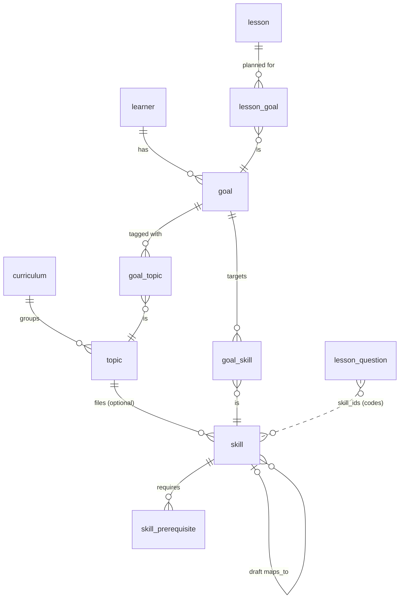

# How does a goal turn a child's answers into mastery and pick the next lesson from the bank?

Issue: `dl-e8ov.5.37`, under the goals-loop epic `dl-e8ov.5` (milestone 2 in `docs/README.md`)

> **Amended 2026-10-30 by the lead of wave 1 (`dl-e8ov.5.1`)** to the owner's decisions since this
> note and to `docs/research/curriculum-and-skills.md` (`dl-e8ov.5.39`):
> - owner question 1 is answered: the shared curriculum lives in shared Postgres tables in Jadwigo's
>   pod, seeded from versioned files in the repo
>   (`jadwigo-hackathon/decisions/2026-10-30-the-shared-curriculum-lives-in-shared-postgres-tables-seeded-fro`);
> - `skill` is keyed `(pod_id, code)` with no uuid and no `skl_` prefix (the code is what
>   `lesson_question.skill_ids` carries), with `status` reviewed, proposed, draft or retired,
>   `aliases` and `prerequisites`, and no `maps_to`: a mapping is an alias on the pod's copy;
>   `curriculum` gains `code` and `source_url`; `topic` has `code`, `area` and `text`;
> - owner question 3 is answered: mastery is folded on read and kept in `learner_skill_mastery`
>   (`jadwigo-learner-knowledge/decisions/2026-10-30-mastery-is-folded-on-read-from-the-evidence-view-and-also-kept-i`);
> - owner question 2 is answered yes (tags may span subjects), question 5 is parked with other lesson
>   languages, question 6 is no level names for parents, question 7 was dropped by the owner
>   (ruling 58's 2 days stay; the day is a Europe/Warsaw calendar day as a core constant), and
>   question 4 is parked;
> - the evidence view reads `lesson_question.skill_ids` through a one-column security definer,
>   `app.asked_skills()`, because the parent's pod cannot read `lesson_question`.
>
> The migration is `supabase/migrations/20261031120000_learner_knowledge.sql`; where this note and
> the migration differ, the migration wins.

## The answer in 5 lines

1. A goal is the parent's words plus a set of skills, with no stages. Skills come from a shared curriculum catalogue or, before the catalogue covers them, from draft skills private to the pod.
2. Mastery is derived, never typed in. A view lists every judged try per learner and skill: `attempt_answer`, through its attempt question, joined to `lesson_question.skill_ids`. A pure function in `packages/core` folds those rows into Khan's 5 level names under Jadwigo's evidence rules.
3. The next lesson starts from a brief, which code computes over all the learner's active goals: reteach, review, new, recheck, school. An AI workflow turns each brief entry into a need for the bank. The bank returns question sets, code draws the questions, and lesson import writes a lesson and an assignment for the child.
4. The parent sees each goal's status, worked out from its skills, and 3 plain lists: what the child can do now, what needs attention and what comes next. The child sees only the can-do lines they reached. No score, percentage or countdown reaches a child.
5. 7 choices stay with the owner (below). The build is about 10 issues under `dl-e8ov.5`, and 3 of the existing ones need rewriting because they still carry stages.

## Method

Read:

- the decisions in force, listed under "Decisions in force";
- `docs/research/core-data-model.md`, mainly "What is deferred", and `docs/research/parent-login.md`;
- `supabase/migrations/*` on `main`, and the parent-login migration in review (`dl-e8ov.2.37`, PR #105: `account`, `member`, a `goal` name stub). Nothing here assumes it merged; if the stub changes, `goal` below is made whole in this milestone's migration instead;
- the bank repo's `schemas/need.schema.json`, `search-envelope.schema.json` and `set.schema.json`;
- the open issues under `dl-e8ov.5`, `dl-e8ov.2.4`, `dl-liwi.15` and `dl-liwi.17`.

Not done: no SQL was run, no search was sent to the bank, and no learner's data was read. The level rules below are the ones already decided. This note places them in the v0 schema and does not tune them.

## Decisions in force

All of these are under `david-learns/decisions/` unless named otherwise.

- `2026-10-22-goals-come-first-and-the-curriculum-is-a-set-of-tags-jadwigo-sug`:
  - the parent states a goal in their own words and never picks a subject;
  - a goal carries zero or more curriculum tags, and works fully with none;
  - before the catalogue covers a goal, its skills are drafts private to the pod;
  - mastery is keyed by skill alone.

  This **replaces** `2026-10-22-a-goal-belongs-to-one-subject`. What remains of "one subject" is owner question 2 below.
- `2026-10-22-goals-have-no-stages-what-comes-next-is-computed-from-evidence`:
  - goal > skills, with the curriculum's subject > topic > skill as the map;
  - the order comes from prerequisites between skills;
  - the goal's status is computed from its skills;
  - a parent's wish about order is a request the planner weighs, not a record.
- `2026-10-26-a-lesson-can-serve-many-skills-and-several-goals-across-subjects`:
  - one brief covers all of the learner's active goals;
  - a lesson points at any number of goals;
  - mastery is worked out again at the end of every sitting.
- `2026-10-26-a-lesson-needs-no-learner-and-no-skill-and-can-be-shared-by-one`: a lesson's skills are derived from its questions, never set by hand.
- `2026-10-22-the-first-learning-loop-slice-kc-centred-goals-and-stages-khan-n`, point 6, the level rules, and point 7: planning is never blind AI. Its stages are replaced by the decision above.
- `2026-10-03-ruling-58-a-skill-is-secure-when-the-child-gets-it-right-wit`: right without help on 2 different days.
- `2026-10-11-can-do-lines-are-earned-per-knowledge-component` and `2026-10-03-ruling-47-progress-can-do-statements-the-child-sees-what-the`: the child sees only the can-do lines they reached; parents also see the gaps; no countdowns.
- `2026-10-23-diagnostic-lessons-are-the-featured-way-in-and-a-diagnostic-buil`:
  - a claimed diagnostic attempt is the learner's first profile, derived rather than stored;
  - a diagnostic lists the goal templates it can lead to.
- `2026-10-22-curriculum-research-givens-draft-skills-shared-without-origin-sc`:
  - a draft skill joins the shared catalogue only as a new reviewed skill with no trace of its pod;
  - school context is inferred from what parents add, never asked.
- `2026-10-25-the-question-bank-is-searched-for-question-sets-by-agents-sendin`: a search sends a need and returns question sets, and code draws the questions.
- `jadwigo-question-bank/decisions/2026-10-28-the-bank-repo-owns-data-and-search-service-the-product-repo-owns`: the bank owns data and search, and the product owns the lesson draw and everything a parent touches. They meet only at the search envelope.
- `jadwigo-question-bank/decisions/2026-10-28-callers-reach-the-bank-only-through-apps-api-which-invokes-the-b` and `2026-10-28-the-bank-s-search-route-is-post-api-v1-question-searches`.
- `jadwigo-question-bank/decisions/2026-10-28-the-default-search-arm-is-c-keyword-search-over-every-language-p`: skills and curriculum tags are not search filters. Hard filters left 162 of 215 needs with no candidates.
- `jadwigo-platform/decisions/2026-10-28-in-v0-the-server-never-asks-an-explain-question-a-lesson-plays-i`: an explain question carries no evidence in v0.

## The records

Every new table follows `packages/contracts/RULES.md`:
- each row carries `pod_id`;
- a record that belongs to another is named owner first;
- ids are uuid columns, written on the wire with a prefix.

The new prefixes would be `crc_` (curriculum), `top_` (topic) and `skl_` (skill).



| Record | Columns | Notes |
| --- | --- | --- |
| `curriculum` | `id`, `pod_id`, `name`, `country`, `version`, `language`, `created_at` | A real school curriculum, such as the Polish *podstawa programowa* for klasy I-III. Shared ones live in Jadwigo's pod (owner question 1). |
| `topic` | `id`, `pod_id`, `curriculum_id`, `subject`, `name`, `code`, `created_at` | A curriculum category with no order, such as "Edukacja matematyczna > mnożenie", with its official code where one exists. A curriculum tag on a goal is a topic. |
| `skill` | `id`, `pod_id`, `code`, `topic_id` (nullable), `kind` (`accuracy` or `speed`), `can_do` (jsonb, per language, each line with `reviewed`), `status` (`draft` or `reviewed`), `maps_to` (nullable, the reviewed skill a draft became), `source`, `created_at` | `code` is the string `lesson_question.skill_ids` already holds (`math.mul.7x8`), unique per pod. A draft lives in the family's pod, and a reviewed one in Jadwigo's. |
| `skill_prerequisite` | `pod_id`, `skill_id`, `requires` | The order to learn in. For a draft goal, the goal-setting workflow drafts these too. |
| `goal` (grows from the parent-login stub, or is made here if that stub changes) | adds `words` (the parent's own), `can_do` (jsonb, the child's line and the parent's), `lesson_language`, `status` (`active`, `paused`, `reached`, `dropped`) | `name` stays the short label. No stage, and no subject column. |
| `goal_skill` | `pod_id`, `goal_id`, `skill_id` | The goal's skills. A draft can be swapped for its `maps_to` and keep its evidence, because mastery is keyed by the skill code. |
| `goal_topic` | `pod_id`, `goal_id`, `topic_id` | Curriculum tags the parent confirmed. Zero is fine. |
| `lesson_goal` | `pod_id`, `lesson_id`, `goal_id` | The goals a lesson was planned for. A featured lesson has none. |
| `learner` | adds `country`, `curriculum_id`, `school_grade`, `school_language`, all nullable | School context, inferred from what parents add and never asked. |

What does **not** become a table:
- **Mastery:** derived (next section).
- **A lesson's skills:** the union of its questions' `skill_ids`, as the lesson row already has it.
- **Stages:** dropped by decision.
- **Goal templates:** a diagnostic lesson lists them, which `dl-u1y5.10`'s lesson script v2 carries.

`lesson_question.skill_ids` stays a text array of codes, with no foreign key. The bank and lesson import write codes. A code that names no skill row is evidence kept for later: when a skill with that code is made or mapped, its history is already there.

## Mastery

### The evidence

One view, `learner_skill_evidence`, created `with (security_invoker = true)` like `attempt_result`. It has one row per judged try, per skill that the try's lesson question carries:

```sql
select a.learner_id, s.code as skill, x.answered_at, x.correct, x.help_used, x.latency_ms,
       x.try_no, t.mode, asg.hold_verdicts, l.kind as lesson_kind, x.event_id
from attempt_answer x
join attempt t            on t.id = x.attempt_id
join attempt_question q   on q.attempt_id = x.attempt_id and q.seq = x.seq
join lesson_question lq   on lq.id = q.lesson_question_id
join assignment asg       on asg.id = t.assignment_id
join lesson_version v     on v.id = t.lesson_version_id
join lesson l             on l.id = v.lesson_id
cross join unnest(lq.skill_ids) as s(code)
where x.kind = 'try' and x.correct is not null
  and t.learner_id is not null and t.mode = 'real'
```

- An unclaimed anonymous attempt has no learner, so it counts toward nobody. A claimed one counts from the moment of the claim, with nothing rewritten. That is what `dl-e8ov.2.37`'s `claimed_read` policies make readable from the parent's pod.
- A preview never counts.
- An explain question is never asked in v0, so it gives no rows.
- A skip is not a try. It leaves the level where it is, and the brief reads it as a "not sure" signal.
- A held-verdict check counts: the child was not told, but the answer was judged.

### The levels

These are Khan's names under Jadwigo's rules, as decided in the first-loop decision, point 6:

```text
Not started   no evidence
Attempted     tried, not yet right without help
Familiar      right without help (help_used = 0, try_no = 1) once
Proficient    right without help on 2 different days                  (ruling 58)
Mastered      still right at a later spaced review inside a mixed lesson,
              and fast on a speed skill (latency_ms under the skill's threshold)
a miss        drops one level, never to Not started
needs attention   a flag beside the level: a miss in the last 2 lessons, or a slip at review
```

The fold is a pure function in `packages/core`, `masteryOf(evidence[], skill)`, over the rows in `answered_at` order. A rule like "a miss drops one level" is a state machine over ordered evidence. SQL can express it, but it would be hard to read and harder to test. In `core` it gets golden cases, and the store, `jw` and the API all call the same code. Spacing uses FSRS, with the card fields named exactly as `py-fsrs` names them (`dl-e8ov.2.4`), replayed from the same rows. So the review timing is derived too.

The decision says mastery is worked out "at the end of every sitting". On read that holds automatically: each read folds every answer so far. Whether to also keep a cache table is owner question 3.

**Retention.** Mastery lasts exactly as long as the answers it is folded from. Some of those answers go:
- **Unclaimed anonymous attempts** are swept after 3 months, but they never counted toward a learner.
- **A dropped goal** keeps its skills' evidence, because mastery is keyed by skill, not by goal.
- **Erasing a learner or a pod** deletes the answers and with them the mastery (`dl-e8ov.2.2`, the erasure path). A cache table, if the owner wants one (question 3), is deleted on the same path.

### The brief

`brief(learner)` is another pure function in `core`. It takes all active goals' skills, the prerequisites, every skill's level and FSRS due date, and any recent homework tags. It returns the 5 lists the planner reads:
- **reteach:** skills flagged needs attention;
- **review:** Proficient or Mastered skills whose review is due;
- **new:** skills whose prerequisites are Familiar or better;
- **recheck:** Familiar skills waiting for their second day;
- **school:** skills tagged from homework in the last week.

Code computes the brief. The AI never recomputes a level (`dl-liwi.17`).

## How a goal picks the next lesson

```text
parent taps "next lesson" (or the results screen offers one; owner question 4)
  apps/api   GET brief(learner)                                   core, from the evidence view
  workflow   /jadwigo-lesson-compose, one need per chosen brief entry:
               { language: goal.lesson_language, grade: learner.school_grade,
                 skills: [codes], mistakes: [classes seen], can_do, contexts, words }
  apps/api   POST /api/v1/question-searches                       bank Lambda, envelope v1
               -> ranked question sets (set_…), each with problem types and items
  code       draw: from the sets, the questions that
               play in the player (family and question type supported), the learner has not seen,
               spacing allows, and that cover each chosen entry; about 10 in all, with each twin
  workflow   order and story, the lesson's reasoning citing the brief entry per question,
               based_on { question: "bank:<id>", changes[] } and the Khan credit on each
  lesson-import  lesson_question rows (write-once), a lesson_version, lesson_goal rows,
               an assignment { audience: learners, identity: pick } for the pod's learner
  child      plays it on app.jadwigo.pl, as today
```

- **The draw is the product's,** as the bank decision says. It lives in `packages/core` as a pure function over the envelope's rows and the learner's seen questions. `packages/bank` stays the client.
- **Skills are not search filters.** That stays true until the bank maps a need's skills to its rows' skill tags (the default-arm decision). The need carries skills and a can-do line as text, and the reranker does the matching. The draw then checks each drawn question's `skill_ids` against the entry it was drawn for, and says so when none match.
- **A gap is said out loud** (first-loop decision, point 8). When no set fits an entry, the workflow may write the question itself. It marks it `based_on { question: "authored:…" }`, and the parent, not the child, sees that AI wrote it (`dl-e8ov.5.5`).
- **Lesson language.** A lesson mixing goals in different lesson languages is open as `dl-e8ov.5.35` (owner question 5).

**What a need may carry.** A need goes through an AI workflow prompt and then the bank's search, which embeds the text through external endpoints. It carries:
- skill codes, mistake-class ids, a can-do line, contexts, the language and the grade;
- never a learner id, a name, the child's answer text or the parent's own goal words.

Whether a query may carry any text from a learner's own materials is open owner decision `dl-e8ov.5.19`. This loop depends on its answer before the compose workflow runs on real families.

## What the parent sees

The parent home from `dl-e8ov.2.38` grows one level down: learner, then goals.

```text
[the child]                                               [ Next lesson ]
  Tabliczka mnożenia do 100                 on its way
    Can do now        2 × 3 … 5 × 10 (Umiem mnożyć przez 2, 5 i 10)
    Needs attention   7 × 8, 6 × 7 (a miss in the last 2 lessons)
    Next              × 9 (once × 3 is Familiar)
    This week         Familiar → Proficient: × 4; new: × 6
  Ortografia: ó i u                          not started   (a draft goal; no curriculum skill yet)
Lessons      each attempt, newest first, with its results (as tonight)
```

- **A goal's status** is computed from its skills:
  - not started: no evidence on any skill;
  - needs attention: any skill flagged;
  - on its way: some skills Familiar or better;
  - good: every skill Proficient or better.
- **The lists** show can-do lines in the parent's language. A level name appears only in a detail view (owner question 6).
- **The child** sees the can-do lines they reached, "Umiem…", on the lesson's end screen and the child's home. No level, score, percentage, streak or countdown.
- **What the parent can do:** add a goal in their own words, confirm the drafted skills and tags, pause or drop a goal, and ask for the next lesson. A wish about order ("word problems before × 9") goes to the planner as a note, not a record.

## What this means for jadwigo

- The schema grows by 7 tables and some columns, all additive. Nothing in v0 or tonight's parent login is rewritten. It is one migration, a one-way door, in the platform lead's wave.
- `packages/core` gains 3 pure functions: `masteryOf`, `brief` and `draw`. They are the testable heart of the loop.
- 3 existing issues still carry stages or the Django contract and need rewriting before anyone works them: `dl-e8ov.5.1`, `dl-e8ov.5.4` and `dl-e8ov.5.7`. `dl-e8ov.2.4` and `dl-liwi.17` are right in substance but name `dl` verbs and stages in passing.
- The bank route `POST /api/v1/question-searches` (`dl-n9fr.33`) is a dependency, not part of this work.
- **Filing the proposed issues.** One marked "rewrite of" an existing issue is carried out by rewriting that issue in place, never by filing a new one. One marked "narrowed" also rewrites its issue in place. The rest are new.
- **Still provisional, for the owner to confirm with the build:**
  - the goal statuses (`active`, `paused`, `reached`, `dropped`), with no rule yet for `reached`;
  - "good" meaning every skill is Proficient or better;
  - the parent's action list.
- **Not yet covered by a proposed issue:**
  - the spelling diagnostic's readout as a first profile (`dl-e8ov.5.8`);
  - a second throwaway pod running the whole loop (`dl-e8ov.5.8`'s done-when);
  - the `based_on` lint (`dl-e8ov.5.5`).

### The owner's questions, with the lead's recommendation

The outcome block lists the options only, as the research check requires. The recommendations live here.

1. **Where the shared curriculum lives.** I recommend Jadwigo's pod, with a read-only policy for every pod. That is the pattern the featured content and claimed attempts already use, and it keeps rule 12 (every row has a `pod_id`) true.
2. **May one goal's tags span 2 subjects?** The decision that a goal belongs to one subject was replaced by "goals come first", which never said whether a goal's tags may cross subjects. I recommend one subject per goal's tags. The bank searches and the lesson language both run per goal, and "ready for klasa 4" becomes one goal per subject, as the replaced decision suggested.
3. **Mastery on read, or also a cache table?** I recommend on read only for this milestone. A pod's evidence is small, so the fold is cheap. A cache rebuilt at the end of each sitting can come later without changing any reader.
4. **Who starts the next lesson?** I recommend the parent's tap, plus an offer on the results screen. The child never gets a lesson the parent didn't ask for, and nothing nags.
5. **Lesson language across goals (`dl-e8ov.5.35`).** I recommend the planner mixing only goals that share a lesson language, until a family asks for more.
6. **Level names for parents.** I recommend can-do lists and the goal status on the parent home, with Khan's level names only in a skill's detail view. The names mean little without their rules.
7. **What counts as a "different day" (ruling 58), and how fast a speed skill must be.** I recommend:
   - the pod's own time zone, a new `pod.time_zone` defaulting to `Europe/Warsaw`;
   - a per-skill `fast_ms` on speed skills, starting at 3000 ms for times-table facts and tuned on real evidence.

```json jadwigo-outcome
{
  "issue": "dl-e8ov.5.37",
  "question": "How does a goal turn a child's answers into mastery and pick the next lesson from the bank?",
  "answer": "A goal is the parent's words plus skills (no stages) from a shared catalogue or pod-private drafts; mastery is folded in packages/core from a view of judged tries per learner and skill; code computes a brief over all active goals, an AI workflow turns it into needs for POST /api/v1/question-searches, code draws questions from the returned sets, and lesson import writes the lesson and its assignment; the parent sees each goal's computed status and can-do, needs-attention and next lists, the child only reached can-do lines.",
  "status": "answered",
  "sources": [
    "https://drops.medallion.md/sites/jadwigo-data-model/model.html",
    "https://github.com/open-spaced-repetition/py-fsrs",
    "docs/research/core-data-model.md",
    "docs/research/parent-login.md",
    "david-learns/decisions/2026-10-22-goals-come-first-and-the-curriculum-is-a-set-of-tags-jadwigo-sug",
    "david-learns/decisions/2026-10-22-goals-have-no-stages-what-comes-next-is-computed-from-evidence",
    "david-learns/decisions/2026-10-26-a-lesson-can-serve-many-skills-and-several-goals-across-subjects",
    "david-learns/decisions/2026-10-22-the-first-learning-loop-slice-kc-centred-goals-and-stages-khan-n",
    "david-learns/decisions/2026-10-25-the-question-bank-is-searched-for-question-sets-by-agents-sendin",
    "jadwigo-question-bank/decisions/2026-10-28-the-bank-repo-owns-data-and-search-service-the-product-repo-owns",
    "jadwigo-question-bank/decisions/2026-10-28-the-default-search-arm-is-c-keyword-search-over-every-language-p"
  ],
  "owner_decisions": [
    {
      "question": "Where does the shared curriculum (curriculum, topic, reviewed skills) live?",
      "options": [
        "In Jadwigo's pod, readable by every pod through a read-only policy",
        "In tables outside the pod model, with no pod_id (an exception to RULES.md rule 12)"
      ]
    },
    {
      "question": "May one goal's curriculum tags span 2 subjects, now that goals-come-first replaced one-subject-per-goal?",
      "options": [
        "No: one subject per goal's tags; a cross-subject wish becomes one goal per subject",
        "Yes: any tags, and the planner splits searches by subject"
      ]
    },
    {
      "question": "Is mastery computed on every read, or also kept in a cache table?",
      "options": [
        "On read only, folded in packages/core each time",
        "On read, plus a cache table rebuilt at the end of each sitting"
      ]
    },
    {
      "question": "Who starts the next lesson?",
      "options": [
        "The parent taps Next lesson, and the results screen offers one",
        "Jadwigo makes the next lesson after every finished attempt",
        "On a schedule the parent sets"
      ]
    },
    {
      "question": "Which language does a lesson use when its goals have different lesson languages? (dl-e8ov.5.35)",
      "options": [
        "The planner mixes only goals that share a lesson language",
        "The lesson takes the language of the goal with the most questions in it",
        "Each question keeps its goal's language"
      ]
    },
    {
      "question": "Do parents see Khan's level names?",
      "options": [
        "Can-do lists and the goal status on the home; level names only in a skill's detail view",
        "Level names beside every skill on the home",
        "Never; can-do lists only"
      ]
    },
    {
      "question": "What is a 'different day' for ruling 58, and how fast is fast on a speed skill?",
      "options": [
        "The pod's time zone (default Europe/Warsaw) and a per-skill fast_ms, 3000 ms to start for times tables",
        "UTC days and one fixed threshold for every speed skill",
        "The pod's time zone and a threshold from the learner's own median latency"
      ]
    }
  ],
  "proposed_issues": [
    {
      "title": "Goals loop migration: curriculum, topic, skill, skill_prerequisite, goal columns, goal_skill, goal_topic, lesson_goal, learner school context",
      "scope": "supabase/migrations and pgTAP; RLS with a read-only policy on the shared catalogue; the learner_skill_evidence view (security_invoker). One-way door, held for the owner.",
      "done_when": "make migrate pgtap green, including a second pod reading shared skills but not another pod's drafts or evidence",
      "depends_on": ["dl-e8ov.2.37"],
      "labels": ["project:jadwigo-platform", "migration"]
    },
    {
      "title": "Contracts for the goals loop: Curriculum, Topic, Skill, Goal (full), Mastery, GoalStatus, Brief, and the goal and lesson routes",
      "scope": "packages/contracts: records, wire, ROUTES (POST /api/v1/goals, GET /api/v1/learners/{id}/goals, GET /api/v1/learners/{id}/mastery, POST /api/v1/learners/{id}/lessons), prefixes crc_, top_, skl_; snapshots",
      "done_when": "contracts tests and the naming test pass; snapshots named in the PR",
      "depends_on": [],
      "labels": ["project:jadwigo-platform", "contracts"]
    },
    {
      "title": "masteryOf in packages/core: Khan's levels with Jadwigo's rules, needs attention, FSRS replay (rewrite of dl-e8ov.2.4)",
      "scope": "packages/core pure fold over evidence rows; golden cases per rule (two days, a miss drops one, speed threshold, review)",
      "done_when": "core tests cover every level transition with golden cases",
      "depends_on": [],
      "labels": ["project:jadwigo-learner-knowledge"]
    },
    {
      "title": "brief in packages/core: reteach, review, new, recheck, school over all active goals (rewrite of dl-liwi.17's code half)",
      "scope": "packages/core pure function from levels, prerequisites, FSRS due and homework tags",
      "done_when": "core tests show each list for a fixture learner with 2 goals",
      "depends_on": ["masteryOf"],
      "labels": ["project:jadwigo-learner-knowledge"]
    },
    {
      "title": "draw in packages/core: questions from bank sets that play, are unseen, are spaced and cover each brief entry",
      "scope": "packages/core pure function over search envelope v1 rows and the learner's seen questions; says each gap",
      "done_when": "core tests draw from a recorded envelope fixture and name a gap when no set fits",
      "depends_on": ["dl-n9fr.33"],
      "labels": ["project:jadwigo-learner-knowledge"]
    },
    {
      "title": "/jadwigo-lesson-compose: from a brief entry to needs, sets, a drawn lesson file with reasoning, based_on and credit",
      "scope": "workflows/jadwigo-lesson-compose and the jw verbs it calls; lesson import writes lesson_goal and a learners assignment",
      "done_when": "an eval composes a lesson for a fixture learner whose every question cites its brief entry and source",
      "depends_on": ["brief", "draw"],
      "labels": ["project:jadwigo-ai-workflows"]
    },
    {
      "title": "Goal-setting workflow without stages: parent's words to goal, skills, draft prerequisites and suggested tags (rewrite of dl-e8ov.5.4)",
      "scope": "workflows/jadwigo-goal-draft; drops stages; the parent's yes before any write",
      "done_when": "an eval drafts goals from 10 parent phrasings with skills and tags a reviewer accepts",
      "depends_on": ["Goals loop migration"],
      "labels": ["project:jadwigo-ai-workflows"]
    },
    {
      "title": "Curriculum seed: klasy I-III maths from the podstawa programowa, with codes, prerequisites and can-do lines (dl-liwi.15 narrowed)",
      "scope": "the catalogue rows for multiplication and the klasa 3 topics the bank's golden needs use",
      "done_when": "the seed loads, and every skill_ids code in the featured lessons names a skill",
      "depends_on": ["Goals loop migration"],
      "labels": ["project:jadwigo-learner-knowledge"]
    },
    {
      "title": "apps/api and packages/store: goal routes, the mastery read and the next-lesson route",
      "scope": "apps/api routes from the contracts; PostgresStore and InMemoryStore read the evidence view and call core",
      "done_when": "route tests for each route on both stores; another pod's goals are 404",
      "depends_on": ["Goals loop migration", "Contracts for the goals loop", "masteryOf", "brief"],
      "labels": ["project:jadwigo-platform"]
    },
    {
      "title": "apps/web parent goals: goal status, can do now, needs attention, next, add a goal, next lesson (dl-liwi.19 narrowed)",
      "scope": "apps/web parent home under each learner; the child's reached can-do lines on the end screen",
      "done_when": "a Playwright test adds a goal, plays a lesson and sees a skill move to Familiar",
      "depends_on": ["apps/api and packages/store: goal routes"],
      "labels": ["project:jadwigo-learner-experience"]
    }
  ],
  "page_changes": [
    {
      "section": "docs/research/core-data-model.md, What is deferred",
      "change": "Goal, skill, curriculum and mastery rows point at docs/research/goals-and-mastery.md"
    },
    {
      "section": "dl-e8ov.5.1, dl-e8ov.5.4, dl-e8ov.5.7",
      "change": "Rewrite without stages, Django or dl verbs, against the records here"
    }
  ]
}
```
