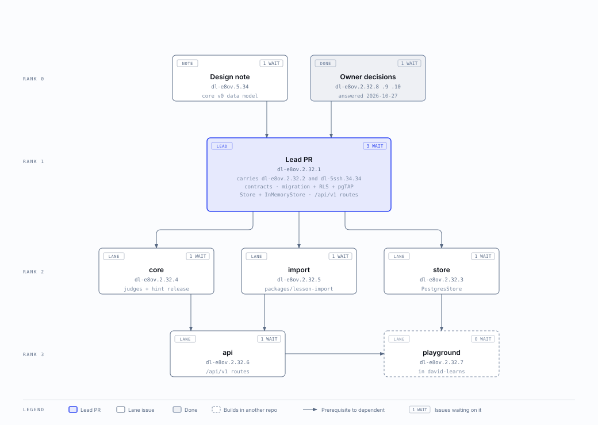

# dl-e8ov.2.32: wave 1 plan

Epic `dl-e8ov.2.32`, core data model v0: a lesson played from the database. Lead: the session
that wrote this, 2026-10-27. Wave label: `wave:dl-e8ov.2.32-1`.

## Goal

The playground's player plays a lesson from Postgres through a local `apps/api` under `/api/v1`.
After the lesson it lists every attempted question, with a basic analysis computed by the
`attempt_result` view. The model and the names are in `docs/research/core-data-model.md`
(`dl-e8ov.5.34`), amended in the lead's PR to the decisions below.

## Decisions in force

Every one of these is under `jadwigo-platform/decisions/`. The 3 owner decisions the note left open
were answered on 2026-10-27, so no lane waits on an owner decision.

- `2026-10-27-jadwigo-ids-are-uuid-v4-in-the-database-written-as-a-prefix-and` (answers `dl-e8ov.2.32.8`)
- `2026-10-27-a-released-hint-is-a-counter-on-the-attempt-question-copied-into` (answers `dl-e8ov.2.32.9`)
- `2026-10-27-before-supabase-auth-row-level-security-reads-the-caller-s-pod-f` (answers `dl-e8ov.2.32.10`)
- `2026-10-27-the-v0-attempt-rules-questions-only-on-the-wire-the-api-v1-route`
- `2026-10-27-a-lesson-question-carries-the-help-ladder-its-credit-and-structu`
- `2026-10-27-wave-1-of-the-core-data-model-lands-every-data-model-decision-in`
- `2026-10-27-jadwigo-s-data-model-and-api-follow-one-set-of-naming-and-design`: the rules in `packages/contracts/RULES.md`, and the renames below
- `2026-10-27-an-attempt-question-is-written-when-it-is-asked-so-seq-is-the-pl`: the 3 orders, and when an attempt question is written
- Those the epic cites already: `2026-10-27-a-lesson-is-a-dynamic-set-of-lesson-questions-that-can-grow-duri`,
  `2026-10-27-v0-of-the-data-model-is-lesson-assignment-and-attempt-with-their`,
  `2026-10-27-jadwigo-s-rest-api-is-versioned-under-api-v1-and-names-put-the-o`,
  `2026-10-27-sql-migrations-are-the-source-of-truth-for-jadwigo-s-schema`,
  `2026-10-27-in-v0-a-lesson-grows-during-play-by-server-rules-never-by-ai`,
  `2026-10-27-playable-from-the-database-means-the-playground-player-on-the-re`,
  `2026-10-27-teaching-screens-are-out-of-the-v0-lesson-a-v0-lesson-is-questio`.

In short:

| Topic | In force |
| --- | --- |
| Ids | `uuid` columns, v4 by default (`gen_random_uuid()`). On the wire: `<prefix>` and 26 lowercase Crockford base32 characters (`les_01jbx…`). The lesson import uses uuid v5 of (pod, file id, position). `event_id` is the page's bare uuid. |
| Help | A counter, `attempt_question.help_released`, copied into `attempt_answer.help_used`. |
| Row-level security | `app.pod_id`, set per transaction by the API after `authorize()`. The API connects as a limited role. |
| Wire | No steps. A v0 lesson is a list of questions. `/api/v1` speaks `seq` and `try_no`; the david-learns HttpApi maps the player's fields. |
| Routes | `POST /api/v1/assignments/{id}/attempts`, `GET /api/v1/attempts/{id}`, `POST /api/v1/attempts/{id}/answers`, `POST /api/v1/attempts/{id}/questions/{seq}/help`, `PATCH /api/v1/attempts/{id}` (`status`), `GET /api/v1/attempts/{id}/results`. The server finishes an attempt. |
| Order | `position` (planned 1 to n, then spares), `seq` (play order: an attempt question is written when asked, never ahead), `try_no` (per attempt question; a skip takes the next one). |
| Growth | `assignment.after_not_sure` (`next`, `twin_now`, `review_round`) and `assignment.hold_verdicts`. An added question is `added = twin` with `placed` `now` or `review_round`. Rung 4 of the help ladder ends the question skipped (`help_twin`) and appends a twin. A twin is asked once per attempt. |
| Attempt answers | `attempt_answer`, append-only, `kind` `try` or `skip`. `unique (attempt_id, seq, try_no)`: a 2nd event id for one try is 409 `AnswerConflict`. An attempt question ends `correct` or `skipped`; no `abandoned` in v0. |
| Lesson question | `help` (the ladder with Khan's hints, no twin), `credit`, `subject` (enum), `grade`, `skill_ids` (checked pattern, GIN). `lesson` has `category`, `subject`, `grade` and `skill_ids`. No `can_do`, no per-question reason. |

## The lead's PR

`dl-e8ov.2.32.1`, which carries `dl-e8ov.2.32.2` and `dl-5ssh.34.34`. It is one PR, large on purpose
(owner, 2026-10-27), and lanes build against it without editing it.

- **`packages/contracts`**
  - the id codec (uuid to `<prefix>` + base32 and back, with a property test) and the branded ids `pod_`, `lrn_`, `les_`, `lesv_`, `lq_`, `asg_`, `att_`;
  - the family data, key and value schemas, ported from david-learns `frontend/src/families/*/model.ts` (choose, enter, slots, sequence, group, place, explain), with `Verdict` and `PartVerdict`;
  - `Help` and `Credit`, the 10 record schemas, `Subject`, `SkillId` and the `AttemptResult` row;
  - the attempt answer envelope, `AttemptAnswerResult`, `HelpResult` and the error envelope;
  - the `/api/v1` route table, named once;
  - `RULES.md`, the data model and API rules, and `src/naming.test.ts`, which fails every rule marked tested in it, across schema keys, route paths and migration identifiers;
  - JSON Schema snapshots. `learner-id.json` changes form, which is a one-way door, called out in the PR.
- **`supabase/`**
  - the core v0 migration: 10 tables and the `attempt_result` view (`security_invoker`), keys and checks;
  - write-once triggers on `attempt_answer`, `lesson_question`, a published `lesson_version` and its question rows;
  - `app.current_pod_id()`, row-level security on every table, and the `jadwigo_api` role;
  - `tests/shim.sql` (Supabase's roles, the auth schema, `auth.uid()` and `auth.jwt()`) and the pgTAP tests.
- **`packages/store`**: `store.ts` (the v0 Store interface, one method per access pattern, scoped to a pod), `memory.ts` (InMemoryStore), `store.contract.ts` (the shared suite, which `store.test.ts` runs on InMemoryStore), and a `postgres.ts` stub. The package gains Kysely and pg.
- **Scaffolds**: `packages/lesson-import` (its package.json, tsconfig, AGENTS.md and an empty index), and `packages/testing/src/golden/` and `src/lessons/`, which start empty and are exported from `index.ts`. `apps/api` gets the Powertools router dependency.
- **Repo**: a `supabase` job in `ci.yml` (Postgres 17, prod's major version, with pgTAP and `pg_prove`, no Docker; the `integration` job moves to 17 too), `make migrate` and `make pgtap`, `.env.example`, knip, dependency-cruiser and turbo, a layout row in `AGENTS.md`, the amended design note and its diagrams, and this plan.

Done when:
- `make check` passes with the snapshots and the naming test.
- The `supabase` CI job applies the migration and `pg_prove` passes. That covers a 2nd pod seeing no rows (and the test failing with row-level security off), answers refusing update and delete, a published version refusing change, and both unique keys.
- The store suite passes on InMemoryStore.

## Lanes

| Lane | Queue | Owns | Must not touch | Frozen tests | Starts when | State |
| --- | --- | --- | --- | --- | --- | --- |
| lead | `dl-e8ov.2.32.1` (with `.2`, `dl-5ssh.34.34`) | everything in the lead's PR | the lane paths below, once it merges | none | now | draft PR |
| store | `dl-e8ov.2.32.3` | `packages/store/src/postgres.ts`, `src/postgres.int.test.ts`, `src/db/**` (generated types), the package's scripts | `packages/contracts`, `supabase/**`, `store.ts`, `memory.ts`, `store.contract.ts` | `store.contract.ts`, `supabase/tests/*.sql`, contract snapshots | the lead's PR merged | waiting |
| core | `dl-e8ov.2.32.4` | `packages/core/**`, `packages/testing/src/golden/**` | `packages/contracts`, `packages/testing/src/index.ts` | contract snapshots; the golden corpus as synced, with its provenance | the lead's PR merged | waiting |
| import | `dl-e8ov.2.32.5` | `packages/lesson-import/**`, `packages/testing/src/lessons/**`, david-learns `frontend/src/playground/sim/exportLessonFiles.ts` and its test | `packages/contracts`, `packages/store/**`, every other david-learns file | `store.contract.ts`, contract snapshots | the lead's PR merged | waiting |
| api | `dl-e8ov.2.32.6` | `apps/api/**` | `packages/contracts`, every `packages/**` | contract snapshots, `store.contract.ts` | `.4` and `.5` merged | waiting |
| playground | `dl-e8ov.2.32.7` (david-learns) | david-learns `frontend/src/api/jadwigoApi.ts` and its test, `frontend/src/playground/db/**` | the jadwigo repo; `sim/**` and `families/**` in david-learns | `sim/api.test.ts`, unchanged | `.6` and `.3` merged | waiting |

No two lanes share a path. Everything shared, the contracts, the migration, the Store interface and
its suite, the package scaffolds, `packages/testing/src/index.ts` and the wave's new dependencies, is
in the lead's PR.

### The order

1. The design note `dl-e8ov.5.34` merges, then the lead's PR.
2. store, core and import run in parallel. import tests on InMemoryStore, so it doesn't wait for PostgresStore.
3. api, after core and import. Its route tests run on InMemoryStore under `make check`, and it uses PostgresStore when `DATABASE_URL` is set.
4. playground, after api and store. It proves Postgres end to end: equal-groups in DB mode, with a miss, Not sure yet and its twin, pause, reload, resume and finish; `psql` shows the twin's row; the results page matches `attempt_result`.

### The owner decisions and what they held

| Decision | Held | State |
| --- | --- | --- |
| `dl-e8ov.2.32.8` id storage | the lead's PR (codec, snapshots, column types), store, import, api | answered 2026-10-27 |
| `dl-e8ov.2.32.9` hint record | the lead's PR (the migration), store | answered 2026-10-27 |
| `dl-e8ov.2.32.10` where row-level security reads the pod | the lead's PR (policies), store (the connection setting), api (`authorize()`) | answered 2026-10-27 |

While they were open, only `dl-5ssh.34.34` and the core lane could have started.

## The diagrams

- [Content: pod, learner, lesson, its versions and lesson questions](../../research/assets/core-v0-content.svg)
- [Play and evidence: assignment, attempt, attempt question, attempt answer, attempt_result](../../research/assets/core-v0-play.svg)
- [Wave 1 order](../../research/assets/wave-1-order.svg)

Each has an `.html` source beside it, made with the diagram-design skill on the `medallion` profile.

## Stop rules for a lane

Over and above AGENTS.md "When to stop":

- A gap in a contract, the migration or the Store interface goes to the lead as a message, never as an edit.
- Every name, column and route follows `packages/contracts/RULES.md`. A name the rules don't settle goes to the lead.
- No family member's name anywhere. The david-learns lesson sources carry one in a header comment, so the JSON export drops comments. Grep before you commit; gitleaks refuses it too.
